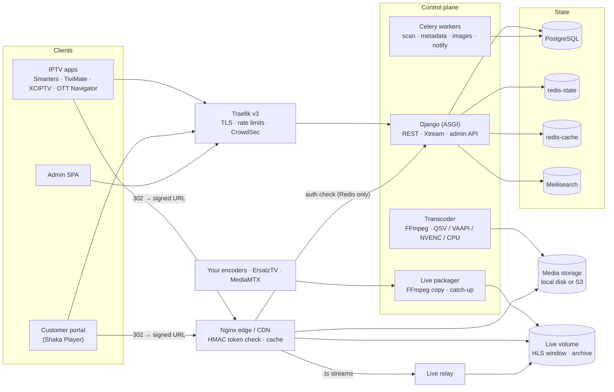

# Smart IPTV

**A self-hosted OTT/VOD subscription platform with an Xtream Codes-compatible API.** It brings library management like Plex/Jellyfin together with an IPTV panel. IPTV Smarters, TiviMate, XCIPTV, OTT Navigator and similar apps work with it out of the box.

> ✅ **Status: feature-complete and running in production at tv.mah007.net.** Milestones M1–M9 and M11–M15 are accepted and tagged. Two wait on the owner: M10 for testing on real devices, and M11b for payment sandbox keys.
> - **Working end to end:** admins (MFA, passkeys) create customers and IPTV logins; libraries are scanned, matched on TMDB (TheTVDB as the TV fallback) in English and Arabic, transcoded once into MP4 and an HLS ladder with per-plan quality ceilings, and served by signed-URL edges; IPTV apps and the customer portal play movies, series and live TV with catch-up.
> - **Business:** plans, subscriptions with grace, invoices with VAT, manual, Stripe and Moyasar payments, emails, and editable privacy and terms pages.
> - **Operations:** monitoring with alerts (email, Telegram), nightly encrypted backups with a weekly restore drill, hardened containers, CrowdSec, a strict CSP, sharing detection, rate limits, and every setting and integration configured in the admin.
> - **Scale:** extra media edges on other hosts, a private S3 origin, a Bunny CDN option, a read replica and zero-downtime updates, all opt-in.
> - **Needs the owner before go-live:** tests on real TVs and phones (M10); a TMDB commercial licence (and TheTVDB's tier past USD 50k revenue); SMTP and alert recipients in the admin; the backup passphrase kept off the server; a lawyer's review of the privacy and terms templates; payment provider keys if cards are wanted.
>
> See the [roadmap](#roadmap), [docs/PROGRESS.md](docs/PROGRESS.md) and the decisions in [docs/adr/](docs/adr/).

## Recent updates

Newest first; each step that lands on `main` adds a line here. Details in [docs/PROGRESS.md](docs/PROGRESS.md).

- **2026-10-16:** the last open items (ADR-0024):
  - **Screenshot regression tests:** `make visual`, 48 baselines across 12 pages in both languages and themes, in `make ci`.
  - **Sharing checks:** media edges now count bytes per session, and sessions that download far more than the title explains are flagged (G-17).
  - **TV logins:** a printable setup card with a QR code, printed in the browser (G-25).
  - **Customer accounts:** optional two-factor sign-in, which support can reset.
  - **Episode order:** TheTVDB's DVD and absolute orders for series matched on TMDB.
- **2026-10-16:** GPU is optional by the owner's decision: servers transcode on the CPU by default, and a GPU server can opt in with a compose overlay. M8 is tagged.
- **2026-10-16:** the follow-ups deployed to tv.mah007.net with a rolling update (no errors, 7 hosts green, contract suite 195 passed). Live TV, privacy and terms pages are live in the portal. Milestones M5 and M11 are tagged; every planned feature is built.
- **2026-10-16:** the last follow-ups (ADR-0023):
  - **Metadata:** TheTVDB as the fallback for TV series TMDB can't match.
  - **Admin:** Devices and Lockouts pages; admins change their own password; customer lists and KPIs follow the governing subscription.
  - **Customers:** they see and stop their other streams from the player, change their password, and get one device per browser.
  - **Portal:** live TV with now/next, a guide and catch-up; editable privacy and terms pages (templates for a lawyer to review).
  - **Live ingest:** MediaMTX encoder sign-ins are managed in the admin.
  - **Fixes:** 720p/480p MP4 copies so capped plans play in Android IPTV apps, and a self-healing settings cache.
- **2026-10-14:** application security and scale deployed to tv.mah007.net:
  - The rolling update replaced the web replicas behind health checks with no errors.
  - Strict CSP headers are live on the admin and portal; the IP geolocation database downloaded.
  - Two web replicas run as the restricted database user, and edges.tv.mah007.net is ready for extra media servers.
  - The live Xtream contract suite passes (195 passed). Milestones M14 and M15 are tagged.
- **2026-10-14:** scale and CDN (M15):
  - **Edges:** media servers on other hosts with their own TLS, managed and health-checked from the admin's Edges page; viewers are spread across them.
  - **Storage and database:** an optional private S3 origin, an optional read replica with a rehearsed failover.
  - **Deploys:** zero-downtime updates (`scripts/rollout.sh`, `make deploy`).
  - **Load tests:** 0 failures at 1,000 virtual users after adding a database connection pool; 5,000 is extrapolated on this machine.
  - **Bunny CDN:** token auth, checked against Bunny's published vectors only.
- **2026-10-14:** application security (M14a):
  - **Admin sign-in and accounts:** security keys and passkeys for admins; step-up before sensitive actions (admins by code or key, customers by password before new TV logins); an optional admin IP allowlist.
  - **Anti-sharing:** sharing detection with DB-IP Lite geolocation (flags with evidence, never automatic locks); country rules now get a country, so they actually apply.
  - **Headers and limits:** a strict nonce-based CSP on both web apps and per-account and progressive rate limits.
  - **Checks and docs:** dependency audits, Semgrep and a ZAP scan in `make ci`, TMDB and DB-IP credits on About pages, and threat model v2.
- **2026-10-14:** scale-out (M15), built and tested on the dev stack:
  - **Media edges on other servers:** an Edges page in the admin, and `install.sh --edge` (its own Let's Encrypt certificate, keys over a control channel). Kicks work across servers.
  - **The S3 origin and Bunny:** a private S3 origin that edges read with a read-only key, and Bunny CDN token auth, verified against test vectors only.
  - **The read replica:** an opt-in PostgreSQL read replica with a lag alert and a rehearsed failover.
  - **Updates without downtime:** two web replicas, replaced behind health checks, and `make deploy`.
  - **Load tests:** at 1,000 IPTV viewers, no failures, play start p95 230 ms and no slot over-allocation; 5,000 is extrapolated. The test also found and fixed database connection exhaustion with a connection pool. [Report](docs/benchmarks/load.md).
- **2026-10-11:** configuration in the admin and backups/hardening deployed to tv.mah007.net:
  - The app now runs on restricted database and cache accounts.
  - The first nightly-style full backup, file backup and restore drill succeeded within minutes of the update.
  - The live Xtream contract suite passes (195 passed).
  - The API and Xtream hosts were down for about 10 minutes during this update, because a pull ran under a strict umask; `install.sh` now guards against that.
- **2026-10-11:** backups and server hardening (M14b):
  - **Backups:** nightly encrypted backups (pgBackRest with continuous WAL archiving, restic for files, optional S3 offsite), point-in-time restore, a restore point before every update, and a weekly restore drill that alerts on failure. The admin's Backups page has *Back up now* and *Run restore drill*.
  - **Data and access:** personal-data retention jobs; least-privilege database roles and cache users.
  - **Hardening:** no Docker socket outside two allow-listing proxies, locked-down containers, TLS options, CrowdSec switched from the admin, and a key-rotation script with seven new runbooks.
- **2026-10-11:** every password and integration is now configured in the admin:
  - Settings → Integrations has TMDB, TheTVDB, email, Stripe, Moyasar and Telegram, each with a Test button; Settings → System shows the server facts.
  - Secrets are encrypted in the database, write-only and audited without values; values already in `.env` keep working until moved in.
  - Logo, name and contacts show in the admin, portal, emails and invoices.
- **2026-10-11:** operations security and backups (M14b). Encrypted backups (pgBackRest with continuous WAL archiving, restic for `.env`, secrets, artwork and optionally media), kept on the server and optionally in an S3-compatible bucket, with point-in-time restore and an automatic weekly restore drill that alerts when it fails; a Backups page in the admin. Also: CrowdSec with a Traefik bouncer (switched in Settings → Security), a restricted database role and Valkey users for the app, no Docker socket outside two allowlisting proxies, every container capability-dropped, read-only and digest-pinned, TLS options for an A+, personal-data retention jobs (Settings → Privacy), `scripts/rotate-keys.sh`, and runbooks for backups, rollback, key rotation, leaks and incidents.
- **2026-10-11:** live TV and monitoring deployed to tv.mah007.net with `install.sh --update --monitoring` (about 3 minutes). Every host answers over HTTPS, including grafana.tv.mah007.net behind the admin sign-in, and the live Xtream contract suite passes (195 passed; the live-channel checks skip until channels are added). Milestones M12 and M13 are tagged.
- **2026-10-11:** monitoring (M13): an opt-in overlay with Prometheus, Grafana, Loki and Alertmanager, 7 dashboards and 27 alerts. Alerts go to email and Telegram, set in the admin (Settings → Monitoring), with a "Send a test alert" button. Grafana opens only through the admin's MFA sign-in, and logs are scrubbed of credentials twice. `install.sh` asks whether to turn it on.
- **2026-10-11:** live TV and EPG (M12): channels you own or license (with licence dates), XMLTV guide import, the Xtream live endpoints and `xmltv.php`, live playback as `.ts` or HLS, and catch-up within a disk budget set in the admin. Also: optional MediaMTX ingest for your own encoders and ErsatzTV sync, the admin Live TV and EPG pages, and two threat-model fixes (one login can't feed two households; no internal addresses as sources).
- **2026-10-06:** one-command server installer, `scripts/install.sh`: it asks for the domain, admin email, sign-in and password, media folder, TMDB and SMTP, checks the server and DNS, installs Docker, and starts everything with HTTPS. `--update` and `--reconfigure` maintain it. See [Install on a server](#install-on-a-server).
- **2026-10-04:** milestones M3, M4, M6, M7 and M9 tagged as accepted after a clean no-cache quality gate; movie playback also checked with FFmpeg through the signed edge.
- **2026-10-04:** live TV and EPG (M12) and monitoring (M13) started.
- **2026-10-04:** the admin panel is complete (M11): billing pages, collections, storage and title media panels, with 88 browser tests in both languages and themes. Deployed.
- **2026-10-04:** the customer portal is live (M11b): browse, Arabic search, the Shaka player with resume, account, TV-app logins with QR codes, checkout. Deployed.
- **2026-10-04:** full transcoding (M8): the HLS ladder with per-plan quality ceilings, 4K/HDR, subtitles (old Windows-encoded Arabic too) and seek thumbnails.
- **2026-10-04:** billing (M3) and the customer API (M6): plans, subscriptions, invoices, payments, emails; catalog, Arabic search, web playback.
- **2026-10-04:** live TMDB metadata on the server (English and Arabic titles).
- **2026-10-03:** proof of concept deployed: admin with MFA, customers with IPTV logins, scan, match, transcode, and IPTV apps playing.

> ⚖️ **For content you own or are licensed to distribute.** Smart IPTV has no torrent, Usenet, indexer or scraper features, and never will. Media enters only through folders or storage buckets that you manage. Every title carries rights-holder and licence fields, and titles hide automatically when their licence expires.

---

## Contents
- [How it works](#how-it-works)
- [Features](#features)
- [Architecture](#architecture)
- [Tech stack](#tech-stack)
- [System requirements](#system-requirements)
- [Quick start (development)](#quick-start-development)
- [Connecting an IPTV app](#connecting-an-iptv-app)
- [Deployment (production)](#deployment-production)
- [Configuration](#configuration)
- [Roadmap](#roadmap)
- [Repository layout](#repository-layout)
- [Development workflow](#development-workflow)
- [Security](#security)
- [Attribution](#attribution)
- [License](#license)

---

## How it works

From a file on disk to a TV screen:

1. The admin drops `The.Matrix.1999.1080p.BluRay.x265.mkv` into the movies library.
2. Smart IPTV detects it and parses *The Matrix* / 1999 / 1080p / HEVC. It matches the file on TMDB and downloads the poster, backdrop, English and Arabic overview, cast, genres, rating and trailer.
3. It transcodes the title **once** into a set of formats that devices can play directly, then publishes it under *Movies → Science Fiction*.
4. The admin creates a customer with a plan (for example 2 connections until a chosen date). The credentials are shown once, with a QR code.
5. The customer enters the server URL, username and password in IPTV Smarters on their TV. Live TV, Movies and Series appear with artwork.
6. On **Play**, the server checks the subscription, expiry, device, connection count and category access. It then redirects the app to a short-lived signed media URL, and playback starts within about 2 seconds.
7. A third simultaneous stream is refused, or the oldest is kicked, depending on the plan. An admin's **Kill session** stops playback within 60 seconds.

## Features

✅ built and running · 🔨 being built now · 🔜 planned (see the [roadmap](#roadmap))

**Library and metadata**
- ✅ Folder watcher plus scheduled reconciliation scans that detect new, changed, moved and removed files.
- ✅ Filename parsing for movies, episodes, multi-episode files, anime absolute numbering and editions.
- ✅ TMDB matching with a confidence score: confident matches publish automatically, and doubtful ones go to a review queue.
- ✅ Metadata in English and Arabic, with posters in WebP/AVIF and blurhash placeholders.
- ✅ **TheTVDB as the TV fallback:** when TMDB has no confident match for a series, TheTVDB is asked (our own v4 client, rate-limited and cached). A series that names its TMDB id is matched there; otherwise it is built from TheTVDB with its aired order and shown with TheTVDB's credit. Reviews, search and rematch can choose either provider. Off until its key is saved.
- ✅ **TheTVDB's DVD or absolute order for TMDB series:** files named after the DVDs or with absolute numbers (anime) are mapped to TMDB's episodes through TheTVDB; set it on the series page, and the series' files are placed again.

**Media processing**
- ✅ **Transcode at ingest and direct-play at runtime.** Each title produces a compatible MP4 (H.264/AAC), an adaptive HLS ladder (1080p/720p/540p/360p) and an optional UHD variant.
- ✅ **MP4s for capped plans:** for plans capped at 720p or 480p, a matching MP4 is remuxed from the ladder in seconds (no encode), so IPTV apps that only play MP4 work on those plans too.
- ✅ Hardware encoding with Intel QSV/VAAPI and NVIDIA NVENC, detected automatically, with CPU fallback.
- ✅ Subtitle extraction and sidecar `.srt` pickup, Arabic encoding fixes (cp1256 to UTF-8), and preview thumbnails for seeking.

**Streaming and anti-sharing**
- ✅ Separate control and streaming planes. Media servers only verify signed tokens and serve bytes; the database never sees a media request.
- ✅ Per-device credentials, server-side concurrency limits, device approval, IP and country rules, and new-device emails.
- ✅ **Sharing detection:** every 5 minutes a score per customer from the providers, countries, impossible journeys and networks per TV login they were seen on (DB-IP Lite geolocation, updated monthly). Flags show their evidence and never lock anyone; admins warn, reset the TV logins or suspend, and *revoke by app* stops every login of one app after a vendor leak.
- ✅ Live session view, with kill, block-device and block-IP actions; a Devices page across every customer with bulk block, unblock and revoke; a Lockouts page (sign-ins, second factors, TV logins and addresses) with unlock.
- ✅ **Media edges on other servers (M15):** add one in the admin's **Edges** page and run `install.sh --edge` on it.
  - Each edge has its own Let's Encrypt certificate and a secret of its own. It receives its keys on a control channel, so nothing else secret lives there.
  - Kicks and the concurrency heartbeats work across servers.
  - New sessions go to edges by health, weight, load and audience (canary customers first). The built-in edge is the fallback.
- ✅ **A private S3 origin (M15):** finished renditions publish to an S3-compatible bucket (SeaweedFS in development; R2, B2 or AWS in production) with our own SigV4 client. Edges read it with a separate read-only key and keep 4 MB slices in their cache. A re-encode publishes a new generation, so caches never serve stale bytes.
- ✅ **Bunny CDN (M15)**, verified against test vectors only (no live pull zone yet): signed URLs with Bunny's token authentication, and pulls from one of our edges with a shared secret. The trade-offs are in [docs/runbooks/cdn-bunny.md](docs/runbooks/cdn-bunny.md).
- ✅ Per-connection rate limits on every edge (after a 16 MB burst), so a whole film can't be pulled at line rate.
- ✅ **Sessions served too many bytes:** the edges count what each playback session was served; a movie or episode session served several times what its runtime and bitrate explain (a shared link, a file pulled again and again) raises a sharing flag with the details on the customer's Security tab. The ratio is a setting; nothing is blocked.

**Xtream compatibility**
- ✅ `player_api.php`, `get.php` (M3U) and `/movie` and `/series` play URLs, with field types that exactly match the PHP panels apps expect.
- ✅ Live channels: the live and EPG actions (`get_live_streams`, `get_short_epg`, `get_simple_data_table`), `xmltv.php` (gzip), live entries with `url-tvg` in `get.php`, and the `/live`, short `/{user}/{pass}/{id}` and `/timeshift` play URLs.
- ✅ Contract tests on every response, plus an automated end-to-end run with IPTVnator.

**Live TV**
- ✅ Channels you own or license, from your encoders, cameras, an ErsatzTV schedule or the optional MediaMTX ingest (RTMP, SRT, RTSP), whose publish and read users are managed in Settings → Integrations (MediaMTX asks the server about every sign-in). Each channel records its rights holder and licence dates and is switched off when the licence ends. There is no playlist import.
- ✅ Sources are encrypted and never shown again, and addresses inside the server are refused. Groups use the plans' category rules; channels have logos, ordering and a source test that probes codecs.
- ✅ Each channel is packaged once (FFmpeg copy) and served by the edge as HLS or one continuous MPEG-TS stream. Channels start when someone watches. Catch-up recording has a disk budget set in the admin, and apps can timeshift.
- ✅ XMLTV guide import from a URL on a schedule, or an upload, with channel mapping and an unmatched view. The guide table is partitioned monthly.
- ✅ **Live TV in the customer portal:** a Live page with groups, what's on now and next, each channel's guide, and recorded programmes to watch from the start (catch-up); the player has a live mode.
- Live channels are copied, not re-encoded, so they need no GPU; real-time re-encoding stays a small CPU-capped fallback.

**Admin and customer apps**
- ✅ Admin SPA in Arabic (RTL) and English, with dark and light themes, a ⌘K command palette, keyboard shortcuts and live dashboards.
- ✅ Customer web portal with a Shaka Player-based player, Continue Watching, search, recommendations, device and TV-app management, and checkout. When the plan's streams are all in use, the player lists them and stops one; customers and admins change their own passwords; a title being prepared says when it'll be ready.
- ✅ **Privacy policy and terms:** editable in the admin (Markdown, English and Arabic), starting from templates to review with a lawyer, and shown at `/privacy` and `/terms`, linked from every footer and the checkout.
- ✅ **Printable setup cards:** when a TV login is shown once (in the admin or the portal's *Add TV app*), **Print setup card** prints the server, username, a QR code and, if ticked, the password, in Arabic or English; the browser prints it or saves it as a PDF, and nothing reaches the server.
- ✅ **Optional two-factor sign-in for customers:** an authenticator app, set up in the portal's account page; every new sign-in on the portal and in apps then asks for its code. Support can switch it off for a customer who lost their phone (audited).
- ✅ **Visual regression tests:** key admin and portal pages in both themes and both directions, at desktop and phone width, compared with committed screenshots in `make ci`.

**Business**
- ✅ Plans, subscriptions, trials, a grace period and expiry reminders.
- ✅ Payments: manual, Stripe and Moyasar (mada, Apple Pay, STC Pay); the card providers switch on with their keys. 🔜 PayPal, HyperPay and Tap.
- ✅ Sequential invoices with VAT, as print-ready pages in Arabic and English (the browser saves them as PDF).
- ✅ Notifications by email, with admin-editable Arabic and English templates; monitoring alerts by email and Telegram. 🔜 Telegram and WhatsApp for customer messages.
- ✅ Branding from the admin: the service name, logos (light and dark), support phone, email and WhatsApp, default language and time zone, shown in both apps, emails and invoices.

**Operations**
- ✅ Prometheus metrics and credential redaction in every log (Django, Nginx and Traefik at the source, Alloy again before Loki, with an automated test).
- ✅ Optional monitoring overlay: seven Grafana dashboards (streaming, transcoding, library, business, platform, edges, hosts and GPU), 30 days of logs in Loki with one request id across Traefik, Django and the edge, and 27 alerts sent by email and Telegram. Admins open it from the admin with their own MFA sign-in; recipients, Telegram, severities and the edge capacity are admin settings; "Send a test alert" checks the whole path.
- ✅ An audit log of every admin action (append-only in the database); sign-in rate limits and lockouts.
- ✅ **Application security:** a strict Content-Security-Policy with a fresh nonce per page on both apps and `default-src 'none'` on the API and media; security keys and passkeys (WebAuthn) for admins, which can be required for owners or admins; "confirm it's you" with a code or key before settings, roles, refunds and deletions, and with the password before a customer adds a TV app; an optional admin IP allowlist; per-account rate limits on searches, playback, checkouts and TV logins, and progressive Xtream sign-in pauses that spare carrier-grade NAT.
- ✅ Encrypted backups: the database with point-in-time recovery (pgBackRest, continuous WAL archiving), plus `.env`, secrets, artwork and optionally media (restic), on the server and optionally in an S3-compatible bucket. An automatic weekly restore drill proves they restore, and alerts if not. The admin's **Backups** page shows it all and has **Back up now**; schedule and retention are in Settings → Backups.
- ✅ **Updates without downtime (M15):** two health-gated web replicas, replaced one set at a time by `install.sh --update` or `make deploy`. A steady load across two rollouts saw no failed request.
- ✅ **A PostgreSQL read replica (M15),** opt-in with `install.sh --replica`: reports read from it while it is current, and fall back to the primary otherwise. It has a lag alert and a failover runbook rehearsed end to end.
- ✅ CrowdSec on Traefik's logs with a bouncer that blocks at the edge (switch and allowlist in Settings → Security); personal-data retention jobs (Settings → Privacy); scripted rotation of every key and password.
- ✅ **Configuration in the admin, not in files.** Integrations (TMDB, TheTVDB, SMTP, Stripe, Moyasar, Telegram) each have a card with its status and a server-side **Test**; secrets are encrypted at rest, never shown again and audited without values; changes apply in every process within seconds, Alertmanager's fallback included. A System page shows the installation's facts and why the few bootstrap secrets stay in `.env`. Older `.env` values keep working and can be moved in with one click.

## Architecture



- **The control plane decides.** Django, PostgreSQL, Redis and Celery handle accounts, catalog, entitlements and billing.
- **The streaming plane serves bytes.** Nginx edges verify an HMAC-signed token, check a 60-second-cached heartbeat in Redis, and stream from local disk or S3. Kicked or expired sessions get 403 on their next request.
- **Live TV is packaged once.** One FFmpeg per watched channel copies the source into HLS on a local volume. The edge serves the segments, and a small relay serves the endless `.ts` stream apps expect. Neither touches the database.
- **Hosts:** `app.` (portal), `api.` (REST), `tv.` (Xtream), `admin.` (admin SPA) and `media.` (edge, small tier).

## Tech stack

| Layer | Choice |
|---|---|
| Backend | Python, Django + Django REST Framework, Celery, Gunicorn/Uvicorn (ASGI) |
| Data | PostgreSQL, two Redis/Valkey instances (state and cache), Meilisearch |
| Media | FFmpeg (jellyfin-ffmpeg build), ffprobe, guessit, rapidfuzz, ffsubsync |
| Frontend | React, TypeScript (strict), Vite, TanStack Router/Query/Table, Tailwind CSS, shadcn/ui, i18next |
| Player | Shaka Player (hls.js fallback) |
| Edge and ingress | Nginx with njs, Traefik v3 |
| Observability | Prometheus, Grafana, Loki, Grafana Alloy |
| Tooling | uv, Ruff, mypy, pytest, pnpm, Vitest, Playwright, Locust, k6 |
| Quality gate | `make ci`, run locally (no hosted CI): lint, types, tests, image build, Trivy, licence gate, pip-audit, pnpm audit, Semgrep (own rules) and a ZAP baseline |

**Pinned today:** Python 3.13, Django 5.2 LTS, Celery 5.6, PostgreSQL 18, Valkey 9.1, Meilisearch 1.54, Traefik 3.7, Node.js 24 LTS, pnpm 12, React 19, Vite 8, Tailwind CSS 4, TypeScript 6.0. [ADR-0001](docs/adr/0001-stack-and-versions.md) lists every version, the date it was checked, and the reason for each deviation from the original spec.

Every dependency imported into our code is permissively licensed (MIT, BSD, Apache-2.0, ISC, MPL-2.0, or LGPL used unmodified), and the licence gate in `make ci` enforces this. GPL/AGPL tools run only as separate processes.

## System requirements

### Software
| Need | Details |
|---|---|
| Operating system | Linux x86_64 is recommended for production. For development, Linux or Windows with Docker Desktop and WSL2. |
| Docker | Docker Engine with the Compose v2 plugin. |
| Basics | `git`, `make`, `curl`, `openssl` and `python3` (curl for `make smoke`, openssl for the secrets script, python3 for the licence gate). Everything else runs in containers. |
| Contributors (optional) | For editor tooling outside containers: [uv](https://docs.astral.sh/uv/) (installs Python 3.13) and Node.js 24 LTS with corepack (pnpm 12). |
| GPU (optional) | Intel iGPU/Arc (QSV/VAAPI via `/dev/dri`) or an NVIDIA GPU with the NVIDIA Container Toolkit. Without a GPU, transcoding falls back to CPU. |

### Network
- Ports **80** and **443** free on the host, for Traefik. In development, `make secrets` switches to port **8080** automatically if 80 is taken.
- DNS records for `app.`, `api.`, `tv.`, `admin.`, `media.` (small tier), `edges.` (standalone edges reach the control plane there) and `grafana.` under your domain. Development uses `*.localhost` with no DNS needed.
- Outbound HTTPS to TMDB, plus any of TheTVDB, SMTP, payment providers, Telegram and WhatsApp that you enable.

### Accounts and keys
- **TMDB API key.** Commercial use needs a TMDB commercial licence. Without a key, development runs on recorded fixtures.
- **TheTVDB** (optional: the fallback for series TMDB can't match, and TV ordering). Free below USD 50,000 of yearly revenue with its credit shown (the apps show it); a paid tier above.
- Payment provider, SMTP, Telegram bot and WhatsApp Business accounts, as needed. Keys are entered in the admin (**Settings → Integrations**), not in files.

### Hardware sizing
These are starting points. The M15 load test ([docs/benchmarks/load.md](docs/benchmarks/load.md)) measured 1,000 concurrent IPTV viewers on one 10-core, 16-thread machine, with web using about one core in steady state and about seven during a burst of 50 first sign-ins a second. Plan more web workers, or a second app host, for 5,000.

| Setup | CPU | RAM | Disk |
|---|---|---|---|
| Development laptop | 4+ cores | 8 GB (about 1 GB more with the monitoring overlay) | 40 GB free, plus sample media |
| Small production (single host) | 8+ cores (CPU transcoding; a GPU is optional and speeds up ingest) | 16–32 GB | NVMe for database and transcode scratch, plus library storage (below) |

**Storage.** Plan for the source file plus about **7–9 GB per hour of 1080p content** for renditions. That is the HLS ladder at about 5.4 GB per hour plus the compatible MP4. The UHD variant adds about 7.5 GB per hour when enabled.

**Bandwidth.** This is usually the real limit. A 1080p stream uses about **6–8.5 Mbps**, so **100 concurrent viewers need about 0.6–0.85 Gbps** of egress. Keep at least 30% headroom at peak. For larger audiences, use the CDN tier.

## Quick start (development)

```bash
git clone https://github.com/mah007/iptv.git smart-iptv && cd smart-iptv
make secrets   # create a git-ignored .env with generated secrets (picks port 8080 if 80 is busy)
make up        # build, start everything with hot reload, wait for healthchecks, run migrations
make smoke     # check routing, isolation and readiness through Traefik
```

`make up` prints the URLs. With the default port 80 they are:

| URL | What |
|---|---|
| http://admin.localhost | Admin SPA (Arabic/English, light/dark) |
| http://app.localhost | Customer portal |
| http://api.localhost/api/v1/ | Customer REST API for apps (bearer tokens) |
| http://tv.localhost/player_api.php | Xtream API for IPTV apps |
| http://media.localhost/healthz | Media edge: artwork and signed playback URLs |
| http://mail.localhost | Mailpit: emails the stack sends in development |
| http://traefik.localhost | Traefik dashboard (development only) |
| http://grafana.localhost | Monitoring (with `make up MONITORING=1`): open it from the admin's Monitoring page |

On port 8080, add `:8080` to each URL. Modern browsers and curl resolve `*.localhost` to your machine, so no hosts-file edits are needed.

| Command | What it does |
|---|---|
| `make` | List every command |
| `make test` | pytest (against the running stack's real Postgres, Valkey and Meilisearch) and Vitest |
| `make test-backend t="apps/core/tests/test_routing.py -k internal"` | Run selected backend tests |
| `make lint` · `make fmt` · `make typecheck` | Ruff, ESLint and Prettier · auto-format · mypy and tsc |
| `make logs s=web` · `make ps` · `make shell` | Follow one service's logs · status · Django shell |
| `make build` · `make smoke-images` · `make scan` · `make licenses` | Production images · start and health-check them · Trivy CVE and secret scan · licence gate on their dependencies |
| `make ci` | The full quality gate on the committed tree; run it before pushing (there's no hosted CI) |
| `make down` | Stop the stack; data volumes are kept |
| `make up MONITORING=1` | Add the monitoring overlay (Prometheus, Grafana, Loki, Alloy, Alertmanager, exporters; about 1 GB); `MONITORING=1` in `.env` keeps it on, and down/ps/logs need it too |
| `make monitoring-test` | Monitoring configs, alert-rule unit tests, dashboard queries and the log-redaction pipeline test, in Docker without the stack (part of `make ci`) |
| `make monitoring-smoke` · `make monitoring-firedrill` | With the overlay up: targets, rules, the admin-only Grafana and a request id traced in Loki · a test alert end to end, read back from Mailpit |
| `make monitoring-dashboards` | Regenerate the Grafana dashboards from `monitoring/grafana/build_dashboards.py` |
| `make backup` · `make restore-test` | Back up now through the `backup` service · the restore drill: the latest backup and WAL restored into a throwaway server and compared with live (part of `make ci`) |
| `make audit` · `make semgrep` · `make zap` | Known vulnerabilities in production dependencies (pip-audit, pnpm audit; exceptions in `scripts/audit-ignore.toml`) · the project's Semgrep rules and their tests · a ZAP baseline against every dev host (report in `dist/zap/out`); all three in `make ci` |
| `make hardening-test` · `make crowdsec-test` | Every production service capability-dropped, read-only, digest-pinned and off the Docker socket (part of `make ci`) · with `CROWDSEC=1`: a banned address gets 403, and the admin's switch works |

Demo data and media:

| Command | What it does |
|---|---|
| `make seed args=--reset-admin-password` | Roles, the owner admin `admin` (password printed once; MFA enrolment at first sign-in), demo customers, plans and subscriptions |
| `make sample-media` | Legal synthetic sample files (FFmpeg test patterns named like real titles) in `./media` |
| `make media-ready` | Adds the sample libraries if missing, then waits until a movie and a series are scanned, matched and transcoded |
| `make live-ready` | The legal synthetic live channel: a test pattern looped by the dev MediaMTX, with a generated guide, waiting until 3 minutes of catch-up are recorded; about a second on reruns |
| `make compat` · `make compat-live` · `make e2e-iptvnator` | Xtream contract suite: offline, against the running stack (a 720p plan's `.mp4` must be a capped MP4), and an IPTVnator journey that signs in and plays |
| `make mediamtx-test` | Live ingest sign-ins: the production MediaMTX asks a throwaway web process about publishing and reading (about 15 s; part of `make ci`) |
| `make e2e-admin` | Admin journeys in Playwright with the host's Chrome (MFA sign-in, create a customer, reset a device, scan, resolve a review, stop a session, add a live channel, set SMTP to Mailpit and send a test email from Integrations) and axe on every page in English/light and Arabic/dark, plus a 390 px check; needs `make media-ready`. Report in `dist/admin-e2e` |
| `make e2e-portal` | Portal journeys in Playwright (sign in, Arabic search, play The Matrix, continue watching, sign out; live TV and catch-up; a full plan stopping the other stream; changing the password; two-factor sign-in on and off; the setup card) and axe on thirteen pages in Arabic/light and English/dark at 390 px; needs `make media-ready` and `make live-ready`. Report in `dist/portal-e2e` |
| `make visual` | Visual regression: 12 key admin and portal pages in English/light and Arabic/dark, at 1440 and 390 px, against the committed screenshots, from recorded API fixtures under a fixed clock. `UPDATE=1` rewrites changed baselines; `RECORD=1` records the fixtures again from the dev stack first. Report in `dist/admin-visual` and `dist/portal-visual` |

## Connecting an IPTV app

> Works today. The verified client matrix and illustrated guides in Arabic and English arrive in **M10**.

1. In the admin, go to **Customers → Create customer**. Set the access period (or a plan), then add the first device. **Type the username and password you want, or let them be generated.** The password is shown **once**, with a QR code.
   - Usernames: 3–32 letters, digits, `.`, `_` or `-`.
   - Passwords: at least 8 characters of letters, digits and `. _ - ~ @ ! *`.

   These are the characters every IPTV app can put in a URL.
2. In the app, choose **Xtream Codes API** login and enter:
   - **Server:** `https://tv.example.com`
   - **Username / Password:** from step 1
3. Apps that only accept a playlist can use the M3U URL:
   `https://tv.example.com/get.php?username=USER&password=PASS&type=m3u_plus&output=ts`
   Live channels come first in it, and its `url-tvg` points at the guide (`https://tv.example.com/xmltv.php?username=USER&password=PASS`), which apps such as TiviMate load by themselves.

Each TV or app should get its own device credential, so one can be revoked without affecting the others. Customers can add apps themselves from **Account → Devices & TV apps**.

Supported apps include IPTV Smarters, TiviMate, XCIPTV, OTT Navigator, IBO Player, SmartOne and UHF (Apple TV).

> ⚠️ MAC-activated apps store credentials on their vendor's servers.

## Deployment (production)

> **The small tier works today, with a one-command installer.** One host runs everything behind Traefik with Let's Encrypt TLS and HSTS, optionally with monitoring. The live server at tv.mah007.net runs exactly this. It includes encrypted backups with a weekly restore drill, and CrowdSec. Updates replace the web replicas one set at a time, so the site keeps answering (M15). Edges on other servers, the S3 origin, Bunny and the read replica are opt-in additions.

### Install on a server
**You need:**
- **A server:** Ubuntu 22.04/24.04 or Debian 12/13 on x86_64; 4+ CPU cores, 8 GB RAM and 60 GB free disk recommended (2 cores, 4 GB and 25 GB at least), plus space for your media.
- **A domain** with two DNS A records pointing at the server: the domain itself and its wildcard, e.g. `tv.example.com` and `*.tv.example.com`.
- **Open ports:** 80 and 443 reachable from the internet (Let's Encrypt validates on port 80).

**Run, as root:**
```bash
curl -fsSL https://raw.githubusercontent.com/mah007/iptv/main/scripts/install.sh -o install.sh
sudo bash install.sh
```

**It asks**, with sensible defaults (press Enter to accept):
- the domain;
- the owner admin's email (also the Let's Encrypt contact), sign-in name and password (or generates a strong one);
- the media folder (`/srv/media`), and whether to add legal synthetic sample titles to try it out;
- optionally a TMDB token for posters and Arabic/English metadata, SMTP settings for emails (both saved in the admin's settings, where you edit them later), and whether to enable the ufw firewall;
- whether to enable monitoring (default yes with 8 GB of memory or more; about 1.5–2 GB), who gets alert emails (the admin email by default) and an optional Telegram bot and chat;
- where to keep backups (`/var/backups/smart-iptv`; another disk is better), whether to include the media, and optionally an S3-compatible bucket for offsite copies;
- whether to run CrowdSec (default yes), and whether to share with its community blocklist (default no).

**It checks** the OS, CPU, memory, disk, ports 80/443, internet access and the DNS records, and refuses to install over an existing installation.

**Then it:**
1. installs Docker from Docker's repository if needed and downloads the code to `/opt/iptv`;
2. writes `.env` with secrets generated on the server (mode 600; never shown or logged);
3. builds and starts the stack (10–20 minutes the first time);
4. creates the owner admin and the Movies and Series libraries;
5. checks HTTPS on every host and prints the URLs;
6. shows the **backup passphrase** once (also in `/root/smart-iptv-backup-passphrase.txt`): keep a copy away from the server, because no backup can be read without it. The first backup and restore drill run within minutes.

| Task | Command |
|---|---|
| Update to the latest code, keeping every setting | `sudo /opt/iptv/scripts/install.sh --update` |
| Change the domain, admin email, media folder or monitoring (everything else: admin → Settings) | `sudo /opt/iptv/scripts/install.sh --reconfigure` |
| Turn monitoring on (or off) for an existing installation | `sudo /opt/iptv/scripts/install.sh --update --monitoring` (`--no-monitoring`) |
| Turn CrowdSec on (or off) | `sudo /opt/iptv/scripts/install.sh --update --crowdsec` (`--no-crowdsec`) |
| Add the PostgreSQL read replica (or remove it) | `sudo /opt/iptv/scripts/install.sh --update --replica` (`--no-replica`); [docs/runbooks/database-replica.md](docs/runbooks/database-replica.md) |
| Add a media edge on another server | admin → **Edges** → Add, then on that server `sudo bash install.sh --edge --control-url https://edges.<domain> --edge-id … --edge-domain …`; [docs/runbooks/add-edge.md](docs/runbooks/add-edge.md) |
| Update the server from a checkout | `make deploy DEPLOY_HOST=root@<server>` (the pushed `main`; [docs/runbooks/deploy.md](docs/runbooks/deploy.md)) |
| Back up now, or run the restore drill | admin → **Backups**, or `docker compose ... exec web python manage.py backup_now --wait` (`restore_drill --wait`) |
| Restore the database to a point in time, undo an update | [docs/runbooks/backups.md](docs/runbooks/backups.md), [docs/runbooks/rollback.md](docs/runbooks/rollback.md) |
| Rotate a key or password | `sudo /opt/iptv/scripts/rotate-keys.sh <kind>` ([docs/runbooks/rotate-keys.md](docs/runbooks/rotate-keys.md)) |
| Unattended install (secrets in environment variables, never options) | `sudo ADMIN_PASSWORD=... TMDB_TOKEN=... bash install.sh --yes --domain tv.example.com --email ops@example.com` |
| See what it would do, changing nothing | `bash install.sh --dry-run` |
| Every option | `bash install.sh --help` |

The admin enrols an authenticator app (TOTP) at first sign-in. A generated password is shown once and saved to `/root/smart-iptv-admin.txt` (root only): move it to a password manager. `/opt/iptv/.env` and `/opt/iptv/secrets/` are in the nightly backups (encrypted); the backup passphrase is the one thing you must keep elsewhere. Every update first creates a restore point, so it can be undone. The manual steps the installer runs are in [docs/runbooks/deploy.md](docs/runbooks/deploy.md), and the security checklist after installing is in [docs/runbooks/security.md](docs/runbooks/security.md).

### Tiers
| Tier | Layout | Status |
|---|---|---|
| **Small** | One host runs everything. Traefik routes `media.` to the built-in Nginx edge. | ✅ Works; installed by `scripts/install.sh` |
| **Medium / Large** | Standalone edge servers (own TLS, or behind a Bunny CDN with token auth), an S3-compatible origin (SeaweedFS, Cloudflare R2, Backblaze B2) with sliced range caching, and a PostgreSQL read replica. | ✅ Built (M15), tested on the dev stack with a remote edge, SeaweedFS and the replica; not yet run in production. Bunny is verified against test vectors only |

### Beyond the installer
- ✅ **Monitoring (M13):** the `compose.monitoring.yml` overlay (the installer's monitoring question) with Grafana, Prometheus and Alertmanager on `grafana.<domain>` behind the admin's sign-in, and alerts by email and Telegram; what each alert means and what to do is in [docs/runbooks/alerts.md](docs/runbooks/alerts.md).
- ✅ **Live TV (M12):** included in every install and update (the `live` packager, the `live-relay` and the `live-data` volume). The catch-up disk budget and the other live settings are in the admin (**Settings → Live TV**). The optional MediaMTX ingest for your own encoders and OBS is `LIVE_INGEST=1` in `.env` plus `install.sh --update`; its publish and read users are then managed in **Settings → Integrations → Live ingest**. Channels, ingest, ErsatzTV, guides and disk sizing are in [docs/runbooks/live-tv.md](docs/runbooks/live-tv.md).
- ✅ **Backups (M14b):** included in every install and update. pgBackRest takes a full backup weekly and a differential nightly, and archives WAL continuously (at most 5 minutes of data at risk); restic keeps `.env`, `secrets/`, the artwork, a logical dump and optionally the media (renditions are excluded because they can be regenerated). Everything is encrypted, kept in `BACKUP_DIR` and optionally copied to an S3-compatible bucket (Settings → Backups). A restore drill runs weekly; its result and restore time are on the admin's Backups page, and a failure alerts. Restores, disaster recovery and rollback: [docs/runbooks/backups.md](docs/runbooks/backups.md), [docs/runbooks/rollback.md](docs/runbooks/rollback.md).
- ✅ **Server security (M14b):** CrowdSec (opt-in at install, on by default), ufw with SSH rate-limited or limited to your networks, TLS 1.2+ with forward-secret ciphers, least-privilege database and Valkey users, and key rotation. The checklist, CrowdSec commands and the privacy settings are in [docs/runbooks/security.md](docs/runbooks/security.md); for trouble, [leaked-credential.md](docs/runbooks/leaked-credential.md) and [incident-response.md](docs/runbooks/incident-response.md).
- ✅ **Application security (M14a):** included in every update, with nothing to do by hand (the edge's stream-auth secret is generated, the GeoIP databases download on the worker's first start). Then add a security key for each owner (user menu → **Sign-in and security**), consider **Settings → Security** → *Security key required for* and *Admin allowed addresses*, and set SPF, DKIM and DMARC for your mail domain: [docs/runbooks/security.md](docs/runbooks/security.md). Sharing flags: [docs/runbooks/leaked-credential.md](docs/runbooks/leaked-credential.md#sharing-flags).
- ✅ **Zero-downtime updates (M15):** two health-gated `web` replicas (2 × 3 gunicorn workers). `install.sh --update` builds, migrates once, then replaces web and the apps' server behind Traefik's health checks. `make deploy DEPLOY_HOST=…` runs it from a checkout. The first update to M15 restarts web once, because its routing labels change. Migrations must stay backward compatible: [docs/runbooks/deploy.md](docs/runbooks/deploy.md#zero-downtime-updates-m15-adr-0022).
- ✅ **Scale-out (M15):**
  - the S3 origin: **Settings → Storage**, and a Test on **Settings → Integrations**;
  - edges on other servers: **Edges**, plus `install.sh --edge` ([add-edge.md](docs/runbooks/add-edge.md));
  - Bunny ([cdn-bunny.md](docs/runbooks/cdn-bunny.md));
  - the read replica: `--replica` ([database-replica.md](docs/runbooks/database-replica.md)).

  Live TV stays on the main server.
- **GPU transcoding:** a server with an NVIDIA or Intel GPU can add `docker/compose.gpu-nvidia.yml` or `docker/compose.gpu-intel.yml` (the NVIDIA Container Toolkit, or `/dev/dri`, must be available).

### CDN
- Bunny CDN pull zones with token authentication are supported: [docs/runbooks/cdn-bunny.md](docs/runbooks/cdn-bunny.md). They are verified against Bunny's reference implementation and published vectors only, not yet a live zone, and cache hits at Bunny bypass kicks until a token expires.
- **Don't** put video behind Cloudflare's free or pro CDN, because its terms forbid it.
- Never load-test against a CDN or public egress.

### Go-live checklist
- [ ] TMDB commercial licence signed (and a TheTVDB tier if needed); TMDB attribution visible (and TheTVDB's, which the apps show for its series).
- [ ] The privacy policy and terms (Settings → Legal pages) reviewed by a lawyer and adapted; the admin flags a text that is still the template.
- [ ] Every title has rights metadata, and the licence-expiry job is active.
- [ ] TLS rated A+, HSTS on, admin MFA enforced, no default credentials.
- [ ] Secrets only in Docker secrets or SOPS; an automated test proves none appear in images or logs.
- [ ] Nightly DB backups with WAL, and a restore drill passed within the last 7 days.
- [ ] Alerts verified with a fire drill (admin → Monitoring → Send a test alert, once SMTP or Telegram is set).
- [ ] Load test meets targets, with at least 30% bandwidth headroom at peak.
- [ ] Client app matrix passed on real devices.
- [ ] Runbooks written for deploy, rollback, key rotation, DB restore, adding an edge, rebuilding the search index, a leaked credential, and incident response.
- [ ] Privacy policy and terms published in Arabic and English, with data-retention jobs active.
- [ ] Rate limits and CrowdSec active, OWASP ZAP baseline clean, dependency scans clean.

## Configuration

Everything you change while running the service lives in the admin, like any end-user product ([ADR-0019](docs/adr/0019-dynamic-configuration.md)):

| Where | What |
|---|---|
| **Settings → Integrations** | TMDB, TheTVDB, email (SMTP), Stripe, Moyasar, Telegram, the S3 origin, Bunny and live ingest (MediaMTX): one card each with its status (configured, from server config, incomplete, not set) and a **Test**: a test email to yourself, a key check against the provider, a test Telegram message. Save, then Test. |
| **Settings** | Every setting, grouped: branding (names, logos, support contacts, language, time zone), Xtream, playback, library and transcoding, metadata, email, notifications, billing, trials, security, feature flags, live TV, monitoring. Each shows where its value comes from. |
| **Settings → System** | Read-only: version and commit, hosts, folders, monitoring and live ingest, the settings still read from `.env`, the bootstrap secrets (where each lives and why) and key rotations. |

**Secrets** (SMTP password, TMDB token, payment keys, the Telegram bot token) are encrypted in the database with `FIELD_ENCRYPTION_KEY`, never sent back to the browser, never logged, and audited as "changed" without values. Inputs are never prefilled: **Replace**, **Clear**, and for a value from `.env`, **Move into settings** or **Turn off**.

**Changes apply without a restart**, in every process: web, the workers, the transcoder, the live packager, the watcher, and Alertmanager's fallback (which fetches its settings from Django every minute).

**What stays in `.env`, and why:** only what is needed before the database is reachable, or would break the stack if changed live: the domain and hosts, folders, the data stores' passwords, `DJANGO_SECRET_KEY`, `FIELD_ENCRYPTION_KEY` (it decrypts the stored secrets), the media token keys, and the monitoring and MediaMTX containers' own credentials. `install.sh --reconfigure` changes the domain, admin email, media folder and monitoring. Servers installed earlier keep their `.env` TMDB and SMTP values working as a fallback ("from server config") until you move them in; `manage.py settings_report` lists them (names only), and `manage.py set_setting KEY --stdin` sets a value from a script.

## Roadmap

Each milestone ends with a checkpoint: what was built, how to verify it, and an acceptance checklist. A milestone is tagged `m{N}-done` once every criterion passes.

| # | Milestone | Delivers | Status |
|---|---|---|---|
| M1 | Infrastructure & repo | Monorepo; `make up` boots the full stack; `make ci` quality gate green (lint, types, tests, build, Trivy, licence gate); versions pinned in ADR-0001 | ✅ Done |
| M2 | Backend foundation | Redacted structured logs, problem+json errors, OpenAPI and the generated client, settings registry, feature flags, audit log, metrics | ✅ Done |
| M3 | Accounts & subscriptions | Users, roles, devices, Xtream credentials (Argon2id, admin-chosen or generated), admin MFA, plans, subscription activation, expiry and grace jobs, entitlement cache, invoices, payments, notifications | ✅ Done |
| M4 | Library scanner | Watcher, reconciliation scans, move detection, ffprobe, filename parsing, live scan progress, sample media | ✅ Done |
| M5 | Metadata | TMDB client, match scoring, review queue, English and Arabic enrichment, image pipeline, TheTVDB fallback | ✅ Done |
| M6 | Catalog & search | Catalog API, categories, collections, Meilisearch with Arabic normalisation, home rows | ✅ Done |
| M7 | Direct-play streaming | Nginx edge with signed tokens, playback API, concurrency limits, kick, session sweeper | ✅ Done |
| M8 | Transcoding | Rendition planner, GPU detection, compatible MP4, HLS ladder with per-plan ceilings, UHD/HDR, thumbnails, subtitles, retention | ✅ Done (CPU by default; NVIDIA and Intel GPUs optional) |
| M9 | Xtream API | All VOD and series endpoints with exact types, per-plan cache, M3U, contract tests, IPTVnator E2E | ✅ Done |
| M10 | Client compatibility | Verified on Smarters, TiviMate, XCIPTV, OTT Navigator, UHF and a webOS/Tizen app; Arabic and English setup guides | Needs real devices |
| M11 | Admin UI | Every admin page (Devices and Lockouts included), both themes, Arabic RTL and English, shortcuts, live views, accessibility checks | ✅ Done |
| M11b | Customer portal | Browse, search, player with thumbnails, tracks and resume, live TV and catch-up, checkout (manual, Stripe, Moyasar), legal pages | ✅ Done (provider sandboxes need keys) |
| M12 | Live TV & EPG | Channels and groups, XMLTV EPG, live HLS/TS, catch-up and timeshift, ErsatzTV and MediaMTX integrations, live TV in the portal | ✅ Done |
| M13 | Monitoring & logging | Dashboards, alerts, Loki with verified redaction | ✅ Done |
| CFG | Dynamic configuration | Encrypted secret settings with the `.env` fallback, Integrations page with Tests, System page, branding, Alertmanager's fallback from Django, installer writes settings | ✅ Done |
| M14 | Security hardening | Rate limits, CrowdSec, CSP, re-authentication, key rotation, backup and restore drill, ZAP baseline, STRIDE threat model | ✅ Done: operations (M14b) and application security (M14a: CSP, WebAuthn, step-up, IP allowlist, sharing detection, rate limits, dependency/Semgrep/ZAP checks, threat model v2) |
| M15 | Scale & CDN | Standalone edges, S3 origin, Bunny CDN token auth, Postgres replica, load-test report at 1,000+ virtual users | ✅ Done: edges on other servers with their own TLS, the S3 origin, Bunny (vectors only), the read replica, zero-downtime updates, load tests at 100/500/1,000 (5,000 extrapolated; [report](docs/benchmarks/load.md)) |
| Later | Beyond v1 | Native TV apps, pluggable ML recommender | Ideas |

## Repository layout

```
backend/     Django apps: accounts, billing, catalog, library, metadata, media,
             playback, xtream_api, live, engagement, search, notifications, audit, dashboard,
             antisharing
frontend/    pnpm workspace: packages/ui (design system), packages/api (generated client),
             apps/admin, apps/portal
streaming/   Nginx edge config, njs token verification, FFmpeg rendition profiles
docker/      Dockerfiles and compose files (base, dev, prod, GPU, monitoring, CrowdSec), Traefik config
monitoring/  Prometheus rules, Grafana dashboards, Loki and Alloy config
compat/      Xtream JSON schemas, golden fixtures, client checklist
loadtests/   Locust (make loadtest) and the zero-downtime probe
scripts/     installer, secrets, sample media, key rotation, hardening and CrowdSec checks,
             the dependency audit gate
security/    ZAP baseline plan (accepted findings with their reasons); .semgrep/ holds our rules
docs/        PROGRESS.md, ADRs (docs/adr/), runbooks, threat model, client setup guides (ar/en)
```

## Development workflow

- Work happens milestone by milestone: plan, record decisions as ADRs (`docs/adr/`), build in small verified steps, then stop at a checkpoint. Status lives in [docs/PROGRESS.md](docs/PROGRESS.md).
- Commits follow [Conventional Commits](https://www.conventionalcommits.org/), for example `feat(playback): …` or `fix(xtream): …`.
- There's no hosted CI ([ADR-0003](docs/adr/0003-no-hosted-ci.md)). `make ci` is the quality gate. It runs:
  - the stack and smoke test;
  - lint (with a missing-migrations check) and types;
  - the project's Semgrep rules, a dependency vulnerability audit and a ZAP baseline;
  - the Xtream contract suite;
  - the monitoring checks and the container hardening check;
  - tests, then a backup and a restore drill on the dev stack;
  - sample media scanned and transcoded, live Xtream contract checks, and the IPTVnator journey;
  - the admin and portal browser journeys with axe, and the visual regression screenshots;
  - production images, started and health-checked with `check --deploy`;
  - a Trivy CVE and secret scan, and the licence gate.

  It checks the committed tree, so commit first (or pass `ALLOW_DIRTY=1`), and run it before pushing.
- The frontend lint blocks hard-coded user-facing text (use i18next) and physical left/right Tailwind classes (use logical ones so Arabic mirrors).
- `make api-client` regenerates the typed frontend clients (`packages/api` for the admin, `packages/api-portal` for the portal) after API changes, and `make ci` fails if they're out of date.
- [CLAUDE.md](CLAUDE.md) holds the architecture rules and conventions for AI-assisted development with Claude Code.

## Security

- Per-device Xtream credentials hashed with Argon2id. Failed logins look identical whether the user or the password was wrong.
- Short-lived HMAC-signed media URLs with key rotation, and optional IP binding.
- Server-side concurrency limits, with sessions killable within 60 seconds.
- Admin MFA with an authenticator app or security keys and passkeys (WebAuthn, can be required per role), "confirm it's you" before sensitive actions, an idle timeout and an optional IP allowlist; customers confirm their password before adding a TV app and can turn on two-factor sign-in.
- Rate limiting at Traefik and in Django (per IP and per account), progressive Xtream sign-in pauses, CrowdSec, and an append-only audit log.
- A strict Content-Security-Policy with per-request nonces and no inline script on both apps, `default-src 'none'` on the API and media, and the other security headers per host (`make smoke` checks them).
- Sharing detection with DB-IP Lite geolocation and the bytes each session was served: flags with evidence and a manual warn, reset, suspend ladder; never an automatic lock.
- Supply chain: pinned lockfiles, a licence gate, Trivy, pip-audit and pnpm audit, the project's own Semgrep rules and a ZAP baseline, all in `make ci`. The STRIDE [threat model](docs/security/threat-model.md) gives every finding its status.
- Least privilege on the server: the app uses a database role that can't change the schema or rewrite the audit log, and Valkey users without dangerous commands; only two allowlisting proxies reach the Docker socket; every container drops all capabilities, can't gain privileges, has a read-only root and a digest-pinned image (`make hardening-test` enforces it).
- Encrypted backups with point-in-time recovery and a weekly restore drill; scripted rotation of every key and password; personal-data retention jobs.
- Credentials and tokens are redacted in every log pipeline (Traefik, Nginx, Django, Alloy), and a test enforces it.

Please report vulnerabilities privately to the maintainer via [mah007.net](https://mah007.net), not in a public issue.

## Attribution

- This product uses the TMDB API but is not endorsed or certified by TMDB.
- IP geolocation by [DB-IP](https://db-ip.com) (DB-IP Lite, CC BY 4.0).

## License

Proprietary. All rights reserved.

---

<p align="center">Made with ❤️ for the streamers community by <strong>Mahmoud AbdelLatif</strong> · <a href="https://mah007.net">mah007.net</a></p>
