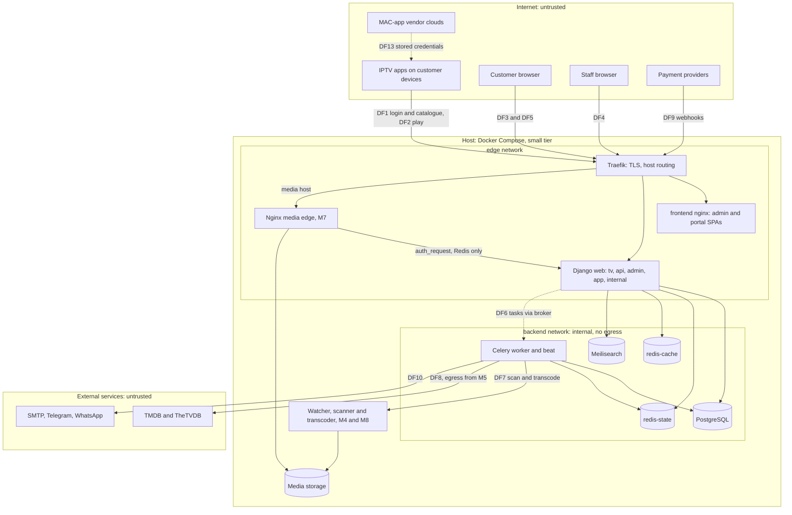

# Threat model (STRIDE)

| | |
|---|---|
| **Version** | 2, reviewed for M14 acceptance, 14 October 2026 (version 1: draft, 3 October 2026) |
| **Covers** | The system as the spec describes it (all milestones), compared with what is built: `main` at `67b4f61` (through M14b) plus application security (M14a, [ADR-0021](../adr/0021-application-security.md)); scale and CDN (M15, [ADR-0022](../adr/0022-scale-edges-origin-replica-and-rollouts.md)) is being built at the same time and is covered where it changes the picture |
| **Method** | STRIDE per element on a level-1 data-flow diagram, with qualitative likelihood and impact |
| **Review** | At every milestone checkpoint. A reviewed version is part of M14 acceptance (spec §16) |
| **Handling** | Published with the M14 fixes (owner's decision). Every gap in [section 10](#10-gaps-and-recommendations-by-milestone) has a status; the ones still open are G-22 (accepted until the M10 client tests) and G-45 (the owner's licensing decision). G-17 and G-25 were closed in V1 ([ADR-0024](../adr/0024-visual-regression-byte-flagging-setup-cards-customer-2fa-tvdb-orders.md)) |

## Contents

1. [Summary: highest risks](#1-summary-highest-risks)
2. [Scope and assumptions](#2-scope-and-assumptions)
3. [How to read this document](#3-how-to-read-this-document)
4. [System and data flows](#4-system-and-data-flows)
5. [Assets](#5-assets)
6. [Threat actors](#6-threat-actors)
7. [Trust boundaries](#7-trust-boundaries)
8. [STRIDE analysis per element](#8-stride-analysis-per-element)
9. [Abuse cases: credential sharing and reselling](#9-abuse-cases-credential-sharing-and-reselling)
10. [Gaps and recommendations by milestone](#10-gaps-and-recommendations-by-milestone)
11. [Maintenance](#11-maintenance)
12. [Review log](#12-review-log)

## 1. Summary: highest risks

1. **Revocation can lag.** A revoked, reset or blocked Xtream credential can keep working from the 5-minute auth cache, whose key is derived from the plaintext the server no longer has, and its running streams continue until their tokens expire (G-02). **Fixed:** cached logins check the credential and its stored hash (M9), and since M14a a reset or revocation also ends the device's streams.
2. **One slot can serve two households.** The session identity `sha256(user, device, title)` merges two clients watching the same title on one credential into one session and one concurrency slot. With live channels (M12), that lets one credential feed many viewers of the same match (G-13). **Fixed in M12:** the client network is part of the session identity.
3. **The edge must bind tokens to what they unlock.** Stream-auth must require an existing session, and the edge must check the requested title and rendition against the token, or a leaked key or a cheap token unlocks everything (G-14, G-15). **Fixed in M7.**
4. **Client IP trust.** Lockouts, the audit trail, IP rules and anti-sharing scores all depend on the client IP; it must come only from the trusted proxy (G-04). **Fixed in M3.**
5. **Traefik holds the Docker socket.** The `:ro` mount protects only the socket file, not the Docker API, so a Traefik compromise means root on the host (G-36). **Fixed in M14b:** Traefik reaches Docker only through a socket proxy that allows container listing and events.
6. **Passwords in messages.** The spec's welcome notification includes a QR code; if it encodes the password as the admin screen does, plaintext passwords end up in the outbox table and in mailboxes (G-28). **Fixed in the commercial slice:** messages carry the server and username, never the password; a test checks every payload.
7. **No backups yet.** The deploy runbook said nothing on the server was backed up until M14 (G-41). **Fixed in M14b:** encrypted backups with point-in-time recovery and a weekly restore drill.
8. **Anti-sharing scoring has no milestone.** Spec §11.1 risk scoring is not in any milestone row of spec §16 (G-27). **Fixed in M14a:** networks, ASNs and countries per customer and per login (DB-IP Lite), a scheduled score with impossible-travel checks, flags with evidence and the manual ladder (warn, reset logins, suspend).
9. **Licensors and DRM.** Xtream apps can't play DRM-protected streams, so every licence must accept non-DRM delivery (G-45).

## 2. Scope and assumptions

**In scope:** everything the spec describes:

- the control plane: Django web, Celery worker and beat, watcher, scanner, transcoder;
- the streaming plane: Nginx edges, later a CDN;
- state: PostgreSQL, redis-state, redis-cache, Meilisearch;
- media storage;
- ingress through Traefik;
- the admin SPA, the customer portal and the Xtream API used by third-party apps;
- external integrations: metadata providers, payment providers and notification channels.

**Deployment:** the small tier from the [deploy runbook](../runbooks/deploy.md): one Linux host with Docker Compose, Traefik with Let's Encrypt, the Xtream host on the base name (`tv.example.com`) and the other hosts as its subdomains. The medium and large tiers (standalone edges, S3 origin, CDN, database replica; M15) are covered where they change the picture.

**Owner decision of 3 October 2026** (`docs/plans/m2-m3.md`): proof of concept first. Plans, subscriptions, payments, invoices, trials and notifications move to a final commercial slice. Until then a per-customer access profile (expiry, stream and device limits, quality ceiling, allowed types and categories) feeds the entitlement. This document keeps the spec's milestone numbers and marks moved items **commercial slice**.

**Out of scope:** the internals of third-party IPTV apps and of MAC-app vendor clouds (both treated as untrusted external entities), physical security of the host, volumetric DDoS beyond what the host and a CDN absorb, and content licensing itself (but see AC-7 for the licensor-facing risk).

**Assumptions:**

- **A1.** Staff devices are reasonably maintained, and every staff member uses MFA.
- **A2.** Customer devices and apps are untrusted. Any credential handed to a customer can leak (spec §1, rule 6).
- **A3.** Licensors accept non-DRM delivery for the catalogue. This must be confirmed per licence (AC-7, G-45).
- **A4.** The operator runs `make ci` before deploying ([ADR-0003](../adr/0003-no-hosted-ci.md)) and keeps `.env` only on the server.

## 3. How to read this document

**Status tags** on every mitigation:

| Tag | Meaning |
|---|---|
| **Built** | Committed and passing `make ci`: M1 and the production overlay |
| **In progress** | In the M2 working tree on 3 October 2026, not yet committed |
| **M3 slice** | Approved for the current slice (M3-lite), not built yet |
| **Planned Mx** | Specified for milestone Mx, not built |
| **G-nn** | A gap: not covered by the spec as written, or covered but needing a specific design decision. See [section 10](#10-gaps-and-recommendations-by-milestone) |

**Ratings** (L = likelihood, I = impact):

| | High (H) | Medium (M) | Low (L) |
|---|---|---|---|
| **Likelihood** | Commodity attack, or routinely seen against IPTV services | Needs skill, an insider position or a specific condition | Needs several unlikely conditions together |
| **Impact** | Many customers' credentials or the licensed catalogue exposed; host compromise; licensor, legal or major financial exposure | One account or one component affected; a short outage | A nuisance or a minor information leak |

## 4. System and data flows

`web` sits on both networks; the data stores sit only on `backend`, which has no route from Traefik and no internet egress ([ADR-0002](../adr/0002-foundations-identity-routing-networks.md)).

| ID | Flow | Path | Sensitive content |
|---|---|---|---|
| DF1 | Xtream login and catalogue | IPTV app → Traefik (`tv.`) → web (`xtream_api`) → redis-state (auth cache, `ent:{user}`), PostgreSQL (credential on a cache miss), redis-cache (catalogue JSON) | Username and password in the query or form body |
| DF2 | Xtream play | App → `tv./movie/{u}/{p}/{id}.mp4` → web checks credential, entitlement and slot, creates the session and mints a token → `302` to `media./v/{token}/{id}.mp4` → Traefik (small tier) → Nginx edge checks the HMAC → `auth_request` to web `/internal/stream-auth` (Redis only) → storage | Credentials in the URL path; a bearer token in the URL path; media bytes |
| DF3 | Portal playback | Browser → `app./api/v1/playback/start` → signed HLS URL → edge | Session cookie; token |
| DF4 | Administration | Staff browser → `admin.` (SPA from frontend nginx; `/api` to web with a session cookie, CSRF and MFA) → PostgreSQL and Redis; live feeds over SSE | Staff credentials, TOTP codes, customer data, one-time Xtream passwords |
| DF5 | Customer account | Browser → `app./api` → web; *Add TV app* mints a device credential | Customer credentials, personal data, one-time Xtream passwords |
| DF6 | Background jobs | Beat → broker (redis-state) → worker → PostgreSQL and Redis | Task arguments |
| DF7 | Ingest | Admin-managed library folders or buckets → watcher and scanner (ffprobe, guessit) → transcoder (FFmpeg) → storage; rows to PostgreSQL | Untrusted media files |
| DF8 | Metadata | Worker → TMDB and TheTVDB → image pipeline → storage → edge or CDN | API keys; untrusted JSON and images |
| DF9 | Payments (commercial slice) | Browser → provider's hosted checkout; provider webhook → `api./api/v1/webhooks/{provider}` → `subscriptions.activate` | Signed events and amounts |
| DF10 | Notifications (commercial slice) | Outbox → worker → SMTP, Telegram, WhatsApp | Contact data and message content |
| DF11 | Telemetry | Logs on stderr → Docker json-file (Alloy and Loki from M13); `/metrics` (internal) → Prometheus → Grafana | Request metadata, redacted |
| DF12 | Operations | Operator → SSH → host: `git pull`, `docker compose`, `.env`; Traefik ↔ Let's Encrypt | Secrets, images |
| DF13 | MAC-app provisioning | Customer → vendor website (IBO Player, SmartOne) → vendor cloud → TV app → DF1 and DF2 | Our credentials, stored by a third party |

## 5. Assets

| ID | Asset | Where it lives | Most at stake |
|---|---|---|---|
| AS1 | Licensed media: sources and renditions | Storage, edge caches, CDN | Confidentiality (piracy) and availability; obligations to licensors |
| AS2 | Xtream device credentials | Plaintext only in the create or reset response; Argon2id hash in PostgreSQL; HMAC-keyed auth cache in redis-state; outside our control on customer devices, in M3U links and in MAC-app vendor clouds | Confidentiality |
| AS3 | Customer accounts and personal data: name, email, phone, IP addresses, countries, watch history, payments | PostgreSQL, logs, backups | Confidentiality (Saudi PDPL and similar laws), integrity |
| AS4 | Staff accounts, sessions, TOTP secrets and roles | PostgreSQL (TOTP secrets encrypted with Fernet), session store | Integrity of everything else |
| AS5 | Keys and secrets: Django `SECRET_KEY`, media HMAC keys per `kid`, `FIELD_ENCRYPTION_KEY`, database, Valkey and Meilisearch passwords, provider API keys, TLS and ACME keys | `.env` on the host, the `traefik-acme` volume; Docker secrets or SOPS from M14 | Confidentiality |
| AS6 | Entitlement and session state: `ent:`, `conc:`, `sess:`, `kick:`, auth cache, Celery broker | redis-state | Integrity and availability |
| AS7 | Billing records: payments, invoices, webhook events | PostgreSQL | Integrity and non-repudiation |
| AS8 | Audit log | PostgreSQL, append-only | Integrity and non-repudiation |
| AS9 | Catalogue and rights metadata: categories, adult flags, `rights_holder`, `license_ref`, `license_expires_at` | PostgreSQL, caches, Meilisearch | Integrity: a title whose licence expired must disappear |
| AS10 | Service capacity: egress bandwidth, transcode time, CPU for Argon2 | Host and edges | Availability |
| AS11 | Logs and metrics | Docker logs, later Loki and Prometheus | Must hold no secrets; may hold personal data |

## 6. Threat actors

| Actor | Goal | Typical capability |
|---|---|---|
| Opportunistic attackers and bots | Credential stuffing, scanning, resource abuse | Commodity tools, botnets, leaked password lists |
| Credential sharers and resellers | Watch, or sell access, without paying per household | A legitimate account, many households, reseller channels on Telegram and forums |
| Content pirates | Copy and redistribute licensed titles | A legitimate account, download tools, restreaming servers |
| Malicious client software | Harvest credentials | Lookalike apps and "mod" APKs on customer devices |
| MAC-app vendors, or whoever breaches them | Hold or misuse many customers' credentials | Read access to every playlist customers uploaded |
| Malicious or careless insiders | Free or resold access, snooping, sabotage | Admin or support roles, possibly host access |
| Payment fraudsters | Get service, then charge back | Stolen cards, disputes |
| Supply-chain attackers | Code execution through a dependency or an image | Malicious package versions, compromised images |
| Network attackers | Read credentials on hostile Wi-Fi | Interception, DNS spoofing, TLS downgrade attempts |

## 7. Trust boundaries

| ID | Boundary | What crosses it | Controls |
|---|---|---|---|
| TB1 | Internet ↔ Traefik | All public traffic: DF1 to DF5, DF9 | TLS, HTTP to HTTPS redirect, HSTS, host routing (**Built**); per-IP rate limits on sign-in, Xtream and CSP reports (**Built**, M14a); CrowdSec (**Built**, M14b, opt-in) |
| TB2 | Traefik ↔ web and frontend (`edge` network) | Routed requests | One router per public host, `/internal` excluded (**Built**), `/metrics` excluded (**In progress**), one URLconf per host (**Built**) |
| TB3 | web and workers ↔ data stores (`backend` network) | Queries, cache, broker | No route from Traefik, no egress, passwords (**Built**); separate database roles and Valkey ACL users (**Built**, M14b; G-37, G-38) |
| TB4 | Control plane ↔ streaming plane | Signed tokens (DF2, DF3), `auth_request` | HMAC keys with `kid`, stream-auth on Redis only (**Planned M7**) |
| TB5 | Edge ↔ media storage | File reads, S3 requests | `internal` locations (**Planned M7**); private bucket (**Planned M15**) |
| TB6 | Workers ↔ external services | DF8, DF10, payment API calls | A deliberate egress network ([ADR-0002](../adr/0002-foundations-identity-routing-networks.md), from M5); SSRF guard (G-11) |
| TB7 | Payment providers → webhook endpoint | DF9 | Signatures and idempotency (**Planned**, commercial slice) |
| TB8 | Staff ↔ admin host | DF4 | MFA and RBAC (**M3 slice**), session cookie, CSRF and audit (**Built**); security keys and passkeys (WebAuthn), step-up for sensitive actions and an optional IP allowlist (**Built**, M14a) |
| TB9 | Customer devices and vendor clouds ↔ our hosts | DF1, DF2, DF13 | Per-device credentials and revocation (**M3 slice**); concurrency and kick (**Planned M7**) |
| TB10 | Library content ↔ scanner and transcoder | DF7 | Separate transcoder image (**Planned M8**); sandboxing (G-07, G-39) |
| TB11 | Containers ↔ host | Docker socket, volumes | Non-root app and frontend images (**Built**); the Docker socket only in two allowlisting proxies, capabilities dropped, read-only roots (**Built**, M14b; G-36, G-39) |
| TB12 | Operator ↔ host | DF12 | Secrets generated on the host, `.env` mode 600 (**Built**); ufw policy in the installer (**Built**, M14b); SSH hardening (runbook, G-42) |

## 8. STRIDE analysis per element

Each table lists the threat, its likelihood (L) and impact (I), what mitigates it today or later, and the gap, if any, from [section 10](#10-gaps-and-recommendations-by-milestone).

### 8.1 Customer devices, IPTV apps and vendor clouds (external entities, TB9)

| ID | STRIDE | Threat | L | I | Mitigations | Gap |
|---|---|---|---|---|---|---|
| CL-1 | S | A stolen or leaked credential is used from another device: lost TV, "mod" app, shared M3U link, phishing | H | M | Per-device credentials revocable one at a time (**M3 slice**); concurrency limits (**Built**, M7); risk score and flags (**Built**, M14a); new-device notices to the customer (**Built**, M14a); customer guidance in the [client setup guides](../client-setup/en/README.md) (**Built**) | G-02, G-27 |
| CL-2 | S | Lookalike or trojanised IPTV apps harvest credentials | M | M | The guides name each app's genuine developer and warn about copies (**Built**) | — |
| CL-3 | I | The Xtream protocol puts credentials in URL paths and query strings, so apps, proxies, crash reports and M3U files expose them | H | M | HTTPS on every public host (**Built**); redaction in our own logs (**In progress**); per-device scope keeps each leak small. Accepted protocol risk | — |
| CL-4 | I | MAC-activated apps (IBO Player, SmartOne) store our credentials in the vendor's cloud; one vendor breach leaks many | M | H | Dedicated per-TV credentials and warnings in the guides (**Built**); portal warning (**Planned M11b**, spec §9); `app_hint` on devices (**M3 slice**) | G-26 |
| CL-5 | R | A customer denies sharing or reselling | M | L | Sessions recorded with IP, ASN, country and user agent (**Planned M7**); business events (**Planned M13**) | G-27 |
| CL-6 | D | Buggy apps hammer the API with refresh loops or parallel catalogue requests | M | M | Cached catalogue JSON (**Planned M9**); per-IP and per-username limits (**Planned M9, M14**) | G-20 |

### 8.2 Traefik ingress (process, TB1, TB2, TB11)

| ID | STRIDE | Threat | L | I | Mitigations | Gap |
|---|---|---|---|---|---|---|
| TR-1 | S | Host-header tricks reach internal endpoints | M | H | Routers only for known hosts; `ALLOWED_HOSTS`; each public host has its own URLconf, and only in-network hosts fall back to the internal one; routers exclude `/internal`, and the smoke test checks it (**Built**); `/metrics` excluded (**In progress**) | — |
| TR-2 | T | TLS stripping or downgrade on hostile networks | M | H | Permanent redirect to HTTPS, HSTS for one year including subdomains at Traefik and in Django, secure cookies (**Built**, production overlay); TLS 1.2+ with forward-secret AEAD suites only (**Built**, M14b). Preload is the operator's choice (`DJANGO_HSTS_PRELOAD`) | G-43 |
| TR-3 | R | No ingress request log, so an attack or abuse can't be reconstructed at the edge | H | M | Traefik's access log is off on purpose, because Xtream paths carry credentials (**Built**); Django logs every request with a redacted path and a request id (**In progress**) | G-34 |
| TR-4 | I | The admin hostname is public through certificate transparency and DNS | H | L | MFA (**M3 slice**); optional IP allowlist (**Built**, M14a) | — |
| TR-5 | D | Floods, login storms, slow clients | H | M | Per-IP limits at Traefik on sign-in, Xtream and CSP reports, per-account limits in Django (**Built**, M14a); CrowdSec (**Built**, M14b, opt-in); progressive Xtream limits (**Built**, M14a) | G-20 |
| TR-6 | E | Traefik mounts the Docker socket. The `:ro` flag protects only the socket file: the Docker API stays fully usable, so a Traefik compromise is root on the host | L | H | Socket proxy allowing only container listing and events (**Built**, M14b) | G-36 |

### 8.3 Django web: Xtream host (process, `tv.`, DF1, DF2)

| ID | STRIDE | Threat | L | I | Mitigations | Gap |
|---|---|---|---|---|---|---|
| XT-1 | S | Credential stuffing and brute force on `player_api.php`, `get.php` and play URLs | H | M | Argon2id and constant-time verification (**M3 slice**); the same `auth:0` answer for an unknown user and a wrong password (**Planned M9**); progressive delays per IP and per username (**Planned M9, M14**) | G-01, G-04, G-20 |
| XT-2 | S | Timing differences reveal which usernames exist | M | L | Constant-time compare (**M3 slice**) | G-01 |
| XT-3 | S | A revoked, reset or blocked credential keeps working from the 5-minute auth cache, and its streams play on until their tokens expire | M | H | Cache keyed by an HMAC of the credential pair and checked against the stored hash (**Built**, M9); resets and revocations kick the device's sessions (**Built**, M14a) | G-02 |
| XT-4 | T | Tampered parameters: `category_id`, `stream_id`, `action`, path segments | H | M | Strict schemas for integers and enums (**Planned M9**); every play re-runs the entitlement checks: user, access, device, IP and country, type, category, quality, licence, slot (**Planned M7, M9**, spec §7.4) | — |
| XT-5 | I | The catalogue cache serves one customer's entitlement to another through a key collision | M | M | Cache per plan hash and locale, invalidated on change (**Planned M9**) | G-21 |
| XT-6 | I | Errors leak internals such as stack traces or storage paths | M | M | problem+json with a generic body for server errors (**In progress**); storage keys never serialised (**Planned M6**) | — |
| XT-7 | D | Argon2 makes each failed login expensive, so floods exhaust the web workers | H | M | Cache for successful logins (**Built**, M9); progressive per-network, per-username and per-IP limits, during which only cached logins pass, without Argon2 (**Built**, M14a) | G-20 |
| XT-8 | D | Very large catalogue responses, for example `get_vod_streams` without a category | M | M | JSON built once per plan and locale, compressed (**Planned M9**) | — |
| XT-9 | E | Open redirect or scheme downgrade through the play `302` | L | M | `Location` built only from signed values, HTTPS to HTTPS only (**Planned M7, M9**) | — |

### 8.4 Django web: admin host (process, `admin./api`, DF4)

| ID | STRIDE | Threat | L | I | Mitigations | Gap |
|---|---|---|---|---|---|---|
| AD-1 | S | A staff password is phished or stuffed | H | H | Mandatory TOTP for staff and django-axes with exponential cool-off (**M3 slice**); security keys and passkeys, which policy can require for owners or admins; step-up (code or key) for sensitive actions; optional IP allowlist (**Built**, M14a) | G-40 |
| AD-2 | S | MFA bypass: brute-forcing 6-digit codes, or acting while half-authenticated | M | H | The half-authenticated state lives in the session and is not a login; reused TOTP steps are refused (**M3 slice**) | G-03 |
| AD-3 | S | Session theft or fixation | M | H | HttpOnly and SameSite=Lax cookies (**Built**), Secure in production (**Built**); 30-minute idle expiry (**In progress**) | G-03 |
| AD-4 | T | Cross-site request forgery | M | H | Same-origin API with Django CSRF, the `X-CSRFToken` header, trusted origins limited to the admin and portal hosts (**In progress**) | — |
| AD-5 | T | Privilege escalation through mass assignment or by granting oneself a role | M | H | RBAC permission codes on every endpoint (**M3 slice**); audit of every change (**Built**); grants limited to permissions the grantor holds, owners only for owners, no self role change, step-up for role changes (**Built**, M14a) | G-05 |
| AD-6 | R | Staff deny what they did | M | M | Append-only audit log, enforced by a database trigger, with redacted before and after values (**In progress**) | G-04, G-37 |
| AD-7 | I | Cross-site scripting through metadata, customer notes or file names | M | H | React escaping (**Built**, framework default); strict CSP with per-request nonces, no inline script, documents in their own sandboxed frames, an ESLint ban on raw HTML (**Built**, M14a) | G-08, G-24 |
| AD-8 | I | One-time Xtream passwords persist in caches, logs, audit rows or stored PDFs | M | H | Plaintext only in the create or reset response (**M3 slice**); log and audit redaction mask password fields (**In progress**) | G-06, G-25 |
| AD-9 | I | CSV exports run formulas when opened in a spreadsheet | M | M | — | G-23 |
| AD-10 | I | The API schema helps attackers map endpoints | L | L | OpenAPI schema for staff only (**In progress**) | — |
| AD-11 | D | Live feeds (SSE) and polling exhaust workers | L | M | Bounded update intervals (**Planned M11**) | — |
| AD-12 | E | A limited role such as support reads or changes data beyond its permissions | M | M | Permission checks per endpoint (**M3 slice**); object-level checks (**Planned M11**) | G-05 |

### 8.5 Django web: portal and public REST API (process, `app./api` and `api.`, DF3, DF5)

| ID | STRIDE | Threat | L | I | Mitigations | Gap |
|---|---|---|---|---|---|---|
| PT-1 | S | Customer account takeover: stuffing, weak passwords, brute-forcing the reset OTP | H | M | Argon2id, rate limits, lockouts, email OTP reset (**Built**); optional TOTP on the portal and the API host, single-use codes counted with lockouts, support's audited reset with step-up (**Built**, V1, [ADR-0024](../adr/0024-visual-regression-byte-flagging-setup-cards-customer-2fa-tvdb-orders.md)) | — |
| PT-2 | E | A taken-over account mints Xtream credentials through *Add TV app* and sells them | M | M | `max_devices` (**M3 slice**); password step-up before a TV login is created, and a notice to the customer afterwards (**Built**, M14a) | G-31 |
| PT-3 | T | Theft of refresh tokens used by app clients | M | M | Short-lived access tokens, rotating refresh tokens with reuse detection (**Built**, C1, [ADR-0013](../adr/0013-customer-api.md)) | — |
| PT-4 | I | Account enumeration through sign-up or password reset | M | L | Generic responses (**Planned M11b**) | — |
| PT-5 | E | Insecure direct object references on `me/devices/{id}` or playback ids | M | M | Querysets scoped to the requesting user (**Planned M11b**) | — |

### 8.6 Internal endpoints: stream-auth and metrics (process, TB2, TB4)

| ID | STRIDE | Threat | L | I | Mitigations | Gap |
|---|---|---|---|---|---|---|
| IN-1 | S | Internet clients reach `/internal/*` or `/metrics` | M | H | Internal URLconf only for in-network hosts, Traefik exclusions, a smoke test that expects 404 (**Built**; `/metrics` **In progress**) | — |
| IN-2 | S | Another container on the `edge` network (frontend nginx, Traefik) calls stream-auth with forged `X-Original-URI` or client-IP headers | L | M | Django re-validates the token (**Planned M7**) | G-16 |
| IN-3 | T | After an HMAC key leak, forged tokens create sessions that bypass concurrency | L | H | Keys per `kid`, rotation script (**Planned M7, M14**) | G-14 |
| IN-4 | I | `/metrics` exposes business figures | M | L | Internal only (**In progress**) | — |
| IN-5 | D | A storm of `auth_request` calls reaches Django | M | M | The edge caches each answer for 60 s per token; Redis only, no PostgreSQL (**Planned M7**) | — |

### 8.7 Nginx media edge (process, TB4, TB5, M7 and M15)

| ID | STRIDE | Threat | L | I | Mitigations | Gap |
|---|---|---|---|---|---|---|
| ED-1 | S | Forged or expired tokens | M | H | HMAC-SHA256 with a key id, current and previous key accepted, expiry, optional /24 binding, constant-time compare in njs (**Planned M7**) | — |
| ED-2 | S | A valid token for one title or rendition is replayed against another path, for example a 480p token against a 4K file | M | H | The token binds session, title and rendition (**Planned M7**) | G-15 |
| ED-3 | T | Cache confusion: the cache key leaves out the token, so a request could be served from cache before it is authorised | L | H | `auth_request` runs in Nginx's access phase, before content is served (**Planned M7**) | G-15 |
| ED-4 | R | Disputes about playback or bandwidth | M | L | JSON edge logs with a session-id prefix, bytes and cache status (**Planned M7, M13**) | — |
| ED-5 | I | Tokens leak through `Referer` headers or logs; storage paths leak | M | M | Tokens redacted in logs, `internal` locations, no storage keys in URLs (**Planned M7**); `Referrer-Policy: no-referrer` on the media and Xtream hosts (**Built**) | G-15, G-19 |
| ED-6 | D | Bulk downloading at full line rate exhausts bandwidth | H | M | Slots and short tokens (**Built**, M7); egress alerts (**Built**, M13); per-connection rate limits on every edge, more edges and a CDN tier (**Built**, M15) | G-17 |
| ED-7 | E | Bugs in njs or Nginx | L | H | A small njs surface, unprivileged Nginx, read-only filesystem and dropped capabilities (**Built**, M14b) | G-39 |

### 8.8 Media storage (data store)

| ID | STRIDE | Threat | L | I | Mitigations | Gap |
|---|---|---|---|---|---|---|
| ST-1 | T | Source or rendition files are replaced | L | M | Admin-managed library folders; renditions checked with ffprobe before publishing (**Planned M8**) | — |
| ST-2 | I | Direct access to files or buckets | M | H | Local disk served only through `internal` locations (**Built**, M7); private bucket, a read-only key for the edges, presigned reads (**Built**, M15) | G-44 |
| ST-3 | I | Library content leaks from backups | L | H | Encrypted restic backups, renditions excluded (**Built**, M14b) | — |
| ST-4 | D | The disk fills up: renditions add about 7 to 9 GB per hour of 1080p | M | M | Disk alert at 85% (**Planned M13**); storage page (**Planned M11**) | — |

### 8.9 PostgreSQL (data store)

| ID | STRIDE | Threat | L | I | Mitigations | Gap |
|---|---|---|---|---|---|---|
| DB-1 | T | SQL injection | L | H | Parameterised ORM queries only (spec §11); Ruff's Bandit (`S`) rules in `make ci` (**Built**) | — |
| DB-2 | T, R | The application's database role can drop the audit trigger, delete billing rows or truncate tables | L | H | App (`iptv_app`: no DDL, audit log append-only, purge only through `audit_purge` with floors), owner-as-migrator and read-only reporting roles (**Built**, M14b) | G-37 |
| DB-3 | I | Exposure of personal data and credential hashes | L | H | `backend` network only, no published port, password (**Built**); Argon2id hashes and Fernet-encrypted TOTP secrets (**M3 slice**) | G-41 |
| DB-4 | D | Data loss: disk failure, operator error, a bad migration | M | H | pgBackRest with continuous encrypted WAL archiving, restic for configuration and artwork, optional offsite copies, a weekly restore drill that alerts, restore points before updates (**Built**, M14b; [backups runbook](../runbooks/backups.md)) | G-41 |

### 8.10 redis-state (data store)

| ID | STRIDE | Threat | L | I | Mitigations | Gap |
|---|---|---|---|---|---|---|
| RS-1 | T | Writes to `ent:`, `conc:`, `kick:` or broker keys grant access or end sessions | L | H | `backend` network only, password (**Built**); per-client ACL users, the app without dangerous commands (**Built**, M14b) | G-38 |
| RS-2 | T | Injected Celery messages run unexpected tasks or unsafe deserialisation | L | H | Broker password (**Built**); Celery's default JSON-only content type, not overridden in the settings (**Built**); keep pickle disabled | — |
| RS-3 | I | Plaintext credentials end up in the cache | L | H | Cache keyed by an HMAC of the credential pair, with no plaintext in the value (**Built**, M9) | G-02 |
| RS-4 | D | `noeviction` without `maxmemory`: once memory runs out, writes fail and logins and playback stop | M | H | AOF persistence (**Built**); `maxmemory` (1 GB) with the RedisStateMemoryHigh alert at 80% (**Built**, M14b) | G-35 |

### 8.11 redis-cache and Meilisearch (data stores)

| ID | STRIDE | Threat | L | I | Mitigations | Gap |
|---|---|---|---|---|---|---|
| RC-1 | T | A poisoned catalogue cache | L | M | `backend` network only, password (**Built**); invalidation on change (**Planned M9**) | — |
| RC-2 | I | Search returns titles outside a customer's entitlement | M | M | Server-side filter on entitled categories and `status = ready` (**Planned M6**) | — |
| RC-3 | I | The Meilisearch master key is used for searches | L | M | Meilisearch only on the `backend` network (**Built**) | G-12 |

### 8.12 Celery workers and beat (process)

| ID | STRIDE | Threat | L | I | Mitigations | Gap |
|---|---|---|---|---|---|---|
| WK-1 | T | Expiry jobs miss runs, so expired customers keep access | M | M | Beat-to-worker heartbeat in the healthchecks (**Built**); entitlement TTL capped at one hour and at expiry (**M3 slice**) | — |
| WK-2 | I | Task logs leak secrets | M | M | The same redaction for Celery and every stdlib logger (**In progress**) | — |
| WK-3 | E | Server-side request forgery: workers fetch admin- or provider-supplied URLs (EPG sources, images, S3 endpoints) while sitting next to the data stores | M | H | Data stores require passwords (**Built**) | G-11 |
| WK-4 | D | Task floods: scan storms, notification storms | M | M | Separate queues (**Built**); per-queue concurrency (**Planned M4** onwards) | — |

### 8.13 Library watcher, scanner and transcoder (process, TB10)

| ID | STRIDE | Threat | L | I | Mitigations | Gap |
|---|---|---|---|---|---|---|
| IG-1 | E | Crafted media files exploit FFmpeg, ffprobe, guessit or Pillow | M | H | Separate transcoder image (**Planned M8**); non-root, read-only filesystem, dropped capabilities, no internet (internal network only) (**Built**, M14b) | G-39 |
| IG-2 | T | Symlinks or `..` paths make the scanner read or publish files outside a library | M | M | Only relative paths shown in the UI (**Planned M4**) | G-07 |
| IG-3 | S | Bidirectional-text control characters in file names or titles disguise what admins see in the Arabic and English UI | M | L | — | G-08 |
| IG-4 | D | Huge or malformed files stall the transcode queue | M | M | Retries with backoff, error tail, priorities (**Planned M8**) | — |
| IG-5 | T | Rights fields are edited or ignored, so a title stays published after its licence expired | L | H | Licence-expiry job hides titles (**Planned M6**, spec §1); audit (**In progress**) | — |

### 8.14 Metadata providers (external, TB6)

| ID | STRIDE | Threat | L | I | Mitigations | Gap |
|---|---|---|---|---|---|---|
| MD-1 | S, T | Spoofed or compromised provider data: scripts in overviews, decompression-bomb images | L | M | HTTPS with certificate checks (**Planned M5**); React escaping | G-09 |
| MD-2 | I | An API key leaks through URLs or logs | M | L | Redaction of `api_key=` and similar parameters (**In progress**); sensitive settings masked (**In progress**) | G-10 |
| MD-3 | D | Provider outage or rate limiting | M | L | Token bucket, retries with jitter, 24-hour cache (**Planned M5**) | — |

### 8.15 Payment providers and webhooks (external and process, TB7, commercial slice)

| ID | STRIDE | Threat | L | I | Mitigations | Gap |
|---|---|---|---|---|---|---|
| PY-1 | S | A forged webhook activates a subscription | M | H | Signature verification, unique `(provider, event_id)`, processing in one transaction (**Built**, commercial slice); the payment confirmed with the provider's API before activation (**Built**, M14a) | G-29 |
| PY-2 | T | Amount, currency or plan is changed between checkout and webhook | M | H | A server-side checkout record, compared on every webhook (**Built**, commercial slice) | G-29 |
| PY-3 | R | Payment disputes | M | M | Raw webhook payloads kept, audit (**Built**); disputes suspend the subscription, full refunds end it (**Built**, M14a) | — |
| PY-4 | I | Card data exposure | L | H | Hosted checkout, so card data never reaches our servers (**Built**, by design) | — |
| PY-5 | E | Open redirect through the checkout `return_url` | M | L | — | G-30 |
| PY-6 | D | Chargebacks after credentials were minted | M | M | — | G-29 |

### 8.16 Notification channels (external, commercial slice)

| ID | STRIDE | Threat | L | I | Mitigations | Gap |
|---|---|---|---|---|---|---|
| NT-1 | I | Welcome messages carry the Xtream password. Spec §7.7 includes a QR code in `account_activated`; the admin's QR encodes the password, so the outbox row and the delivered message would hold it in plaintext | H if built as written | H | — | G-28 |
| NT-2 | S | Phishing that imitates our welcome or renewal messages | H | M | The guides tell customers that support never asks for passwords (**Built**) | G-33 |
| NT-3 | T | Template injection by someone editing templates | L | M | Django's template engine with a read-only context and a restricted library, audit, preview in a sandboxed frame with its own CSP (**Built**; the frame since M14a) | — |
| NT-4 | S | Guessable or reusable Telegram link tokens | L | M | — | G-32 |

### 8.17 Observability (process and store, DF11)

| ID | STRIDE | Threat | L | I | Mitigations | Gap |
|---|---|---|---|---|---|---|
| OB-1 | I | Credentials or tokens in logs | H | H | Access logs off in Traefik, the frontend nginx and dev Uvicorn (**Built**) and in production Gunicorn (**In progress**); a redaction processor on every log record, a request log with a redacted path and no query string, and a test that a raw password never appears (**In progress**); Alloy redaction (**Planned M13**) | G-34 |
| OB-2 | T | Log injection through user-controlled fields | M | L | The production JSON renderer escapes control characters (**In progress**) | — |
| OB-3 | I | Grafana or Prometheus exposed to the internet | L | M | Not deployed yet; Grafana behind admin authentication and Prometheus internal (**Planned M13**) | — |
| OB-4 | D | Logs fill the disk | M | M | Docker log rotation, 3 × 10 MB per container (**Built**); 30-day Loki retention (**Planned M13**) | — |

### 8.18 Host, containers and deployment (TB11, TB12)

| ID | STRIDE | Threat | L | I | Mitigations | Gap |
|---|---|---|---|---|---|---|
| HO-1 | E | Container escape or misuse of privileges | L | H | App image runs as uid 10001 without pip; frontend on unprivileged nginx (**Built**); read-only root, dropped capabilities, `no-new-privileges`, socket proxies (**Built**, M14b; `make hardening-test`) | G-36, G-39 |
| HO-2 | I | Secrets leak through git, images or logs | M | H | `.env` generated on the host with `umask 077`, ignored by git and by Docker builds; Trivy secret scan of images and repository (**Built**); the media keys and the edge secret as Docker secrets, integration secrets encrypted in the database (**Built**, ADR-0019, M14a); a Semgrep rule against logging credentials (**Built**, M14a) | — |
| HO-3 | T | A malicious dependency or base image | L | H | Lockfiles, pinned versions, licence gate, Trivy CVE scan (**Built**); pip-audit, `pnpm audit`, the project's Semgrep rules and a ZAP baseline in `make ci`, Renovate configuration with a 14-day release age (**Built**, M14a) | G-39 |
| HO-4 | S | SSH or console compromise of the host | L | H | ufw policy (deny incoming, SSH rate-limited or from given networks) in the installer, SSH hardening in the security runbook (**Built**, M14b) | G-42 |
| HO-5 | D | One host and one web replica: updates cause seconds of downtime, and losing the host loses everything | M | M | Health-gated restarts (**Built**); two web replicas and zero-downtime deploys (**Planned M13 to M15**); encrypted backups with a weekly restore drill and disaster-recovery steps (**Built**, M14b) | G-41 |

### 8.19 Importer (process, I1, [ADR-0025](../adr/0025-imports-from-storage-and-direct-links.md))

| ID | STRIDE | Threat | L | I | Mitigations | Gap |
|---|---|---|---|---|---|---|
| IM-1 | I, E | An admin-typed source host or link reaches our own services or the cloud metadata address (SSRF) | M | H | The egress guard on every host and URL: static when saved, with DNS before every run, and on every redirect of a link; HTTPS only, no downgrade (**Built**, I1). rclone resolves a source's host again itself, so DNS rebinding of a source is not covered (as for FFmpeg's live sources) | — |
| IM-2 | I | Source credentials leak through argv, logs or the API | L | H | Fernet at rest, write-only in the API; rclone reads them from a per-run 0600 config in a private tmp folder (tmpfs in production); errors scrubbed of every secret; the reporting role can't read sources (**Built**, I1) | — |
| IM-3 | T, E | A remote name writes outside the library or overwrites a file | L | H | Library-relative keys checked against `..` and hidden names; staging inside the library; hard-link moves that never overwrite; the importer is the only service with the libraries writable (`make hardening-test`) (**Built**, I1) | — |
| IM-4 | D | An import fills the disk | M | M | The size and the reserve are checked before copying (other running imports counted); a watchdog stops the copy under half the reserve; one or two imports at a time (**Built**, I1) | — |
| IM-5 | R | Media of unknown origin enters the catalogue | M | H | Admin-started imports only (no automation, no torrents or indexers), rights holder and licence reference required and applied to the titles, `import.*` audit entries and a history of who imported what from where (**Built**, I1) | — |

## 9. Abuse cases: credential sharing and reselling

Spec §11.1 assumes that credentials leak and aims to make each leak cheap and visible. The planned controls are:

- per-device credentials, `max_devices` and `max_streams`, with a *reject* or *kick oldest* policy;
- new-device detection with notices to the customer and the admin, and an optional *approve new devices* mode;
- a risk score per user over rolling 1-hour and 24-hour windows: distinct ASNs, distinct countries, impossible travel, more than N distinct /24 networks;
- flags that never lock an account automatically, and a manual ladder: warn, then force a credential reset, then suspend;
- short-lived signed media URLs (runtime plus 2 hours for VOD), optional /24 binding, and *kill session* within 60 seconds.

| ID | Abuse | How it shows | Controls | Residual risk and gaps |
|---|---|---|---|---|
| AC-1 | **Sharing beyond the household:** a customer gives a device credential to relatives or friends elsewhere | One credential used from distant networks; streams at the limit every evening; new countries | Per-device credentials (**M3 slice**); `max_streams` with *reject* or *kick oldest* (**Built**, M7); risk score every 5 minutes with flags and evidence (**Built**, M14a) | Sharing within the stream limit stays possible by design; the score makes it visible (G-27, fixed) |
| AC-2 | **Reseller sub-accounts:** a customer mints the maximum number of device credentials and sells each one | One account's devices spread over unrelated ASNs or countries; generic device names; data-centre or VPN ASNs | `max_devices` (**M3 slice**); *approve new devices* feature flag (**M3 slice**); new-device notices (**Built**, M14a); networks per login in the score (**Built**, M14a) | Keep `max_devices` low by default. Hosting-provider ASNs are shown in the evidence but not scored separately yet |
| AC-3 | **Insider resale:** staff create customers or extend access off the books | Customers without a payment source; extensions without payments; activity concentrated on one staff member | RBAC (**M3 slice**); append-only audit (**In progress**) | Reconcile active customers against payments on the dashboard and review regularly (commercial slice); grant `customers.edit` sparingly |
| AC-4 | **Public leak:** a playlist link or credential is posted on a forum or Telegram channel | Bursts of logins for one username from many IPs; rate-limit hits; concurrency rejections | Progressive per-network, per-username and per-IP limits (**Built**, M14a); concurrency limits (**Built**, M7); revoke and reissue (**M3 slice**); networks per login in the score, *revoke by app* with notices (**Built**, M14a) | — |
| AC-5 | **Signed-URL sharing and restreaming:** a subscriber shares the `302` target or re-serves the stream | One session requested from several networks at stream-auth; bytes well above what the runtime needs | Short token lifetime, kick within 60 seconds, optional /24 binding (**Built**, M7); distinct networks per session, counted by stream-auth (**Built**, M14a) | Choose the default binding after client tests (G-22); connections are throttled per edge and sessions served far more bytes than their title explains are flagged (G-17, **Built**, M15 and V1) |
| AC-6 | **Same-title co-viewing:** two households on one credential watch the same title, or from M12 the same live channel | Hard to see: both share one session and one slot | — | The session identity `sha256(user, device, title)` merges them into one slot, so the stream limit doesn't apply to the most popular title or channel. Fix before live TV (G-13) |
| AC-7 | **Download and redistribute:** a subscriber saves whole files with range requests and re-uploads them | Bytes per session close to the file size within minutes; sequential ranges at full speed | Per-plan `allow_download`, tokens and slots (**Planned M7**) | No DRM or forensic watermarking in v1. Each connection is throttled after a 16 MB burst, and a session pulled again and again is flagged by its bytes (G-17, **Built**, M15 and V1); confirm that licensors accept non-DRM delivery (G-45) |
| AC-8 | **Vendor-cloud breach:** a MAC-app vendor (IBO Player, SmartOne) leaks the playlists customers stored there | Many credentials with that app's `app_hint` log in from new networks | Dedicated per-TV credentials and warnings in the guides (**Built**); portal warning (**Built**, M11b); bulk *revoke by app* with notices (**Built**, M14a) | — |
| AC-9 | **Trial farming** with new phone numbers or emails (commercial slice) | Many trials from one device, network or payment fingerprint | One trial per phone or email, admin approval (**Planned**) | Verify the phone number with an OTP; limit trials per network and per device (commercial slice) |
| AC-10 | **Account takeover for resale:** stuffed portal logins followed by *Add TV app* | New device credentials right after a login from a new network | Rate limits and lockouts (**Built**); password step-up before *Add TV app* and a notice afterwards (**Built**, M14a); optional customer TOTP (**Built**, V1) | Customer TOTP is optional: customers who don't switch it on rely on the password and the step-up |
| AC-11 | **Chargeback fraud:** pay, mint credentials, dispute the charge (commercial slice) | Disputes after heavy use | Webhook idempotency and audit (**Built**); disputes suspend the subscription (**Built**, M14a) | Revoking the logins after a dispute stays an admin decision (*reset app logins*) |

**Legitimate patterns the risk score must tolerate:**

- a phone on mobile data and a TV on home broadband: two ASNs, one household;
- carrier-grade NAT on mobile networks, where many unrelated customers share one IP, so per-IP limits on `tv.` must be generous;
- travel, and customers who use a VPN.

Spec §11.1 already ignores IP churn within one ASN or city and never locks an account automatically.

**Response:** each step of the manual ladder (warn, forced reset, suspension) is audited and the customer is told. The customer's Security tab shows the evidence: the score's signals, impossible journeys, and the networks, providers, countries, devices and apps seen over seven days (G-27, M14a).

## 10. Gaps and recommendations by milestone

Severity follows the ratings in [section 3](#3-how-to-read-this-document). Items marked *(spec)* are already in the spec; they are listed because their timing matters. The status column is version 2's review (14 October 2026): **Fixed** names the milestone and where to look, **Open**, **Accepted**, **Not applicable** and **Documented** say why not.

| ID | Milestone | Recommendation | Severity | Status (v2) | Threats |
|---|---|---|---|---|---|
| G-01 | M3 | For an unknown username, run a dummy Argon2 verification, so Xtream and admin logins take the same time whether or not the user exists | Medium | **Fixed** (M3): unknown usernames verify against a dummy Argon2id hash (Xtream, `apps/accounts/credentials.py`); admin and portal sign-in use Django's backend, which hashes for unknown users too | XT-1, XT-2 |
| G-02 | M3 | Make revocation immediate. Revoking, resetting or blocking a credential must invalidate its auth-cache entries, either through a per-credential index of cache keys written at login (when the plaintext is known) or a per-credential epoch checked on every cache hit. It must also kick the device's sessions (hook for M7) | High | **Fixed** (M9, M14a): a cached login must match the credential and a fingerprint of its stored hash; resetting or revoking a login also kicks its sessions (M14a), and *revoke by app* covers bulk cases (G-26) | XT-3, RS-3, CL-1 |
| G-03 | M3 | Rate-limit MFA verification per half-authenticated session and per user, and rotate the session key after the password step and again after MFA | Medium | **Fixed** (M14a): 5 code attempts per half-authenticated sign-in, 10 per account in 15 minutes; a new session key after the password step and again after the second factor (tests in `test_auth_api.py`, `test_step_up.py`) | AD-2, AD-3 |
| G-04 | M3 | Take the client IP only from the trusted proxy: Traefik is the single trusted hop and replaces untrusted `X-Forwarded-For` values by default. Use that one value for lockouts, the audit `actor_ip`, access rules, stream-auth and the risk score | High | **Fixed** (M3): `apps/core/http.client_ip` takes the address Traefik saw; every limit, rule and audit entry uses it | XT-1, AD-6, AC-1 |
| G-05 | M3 | No self-escalation: staff can grant only permissions they hold, only owners manage the owner role, and limited roles get object-level checks | Medium | **Fixed** (M14a): grants limited to permissions the grantor holds, only owners grant or manage the owner role, no self role change; role, admin and permission changes need a step-up | AD-5, AD-12 |
| G-06 | M3 | Send `Cache-Control: no-store` on every response that carries a plaintext password, and keep such responses out of any response logging | Medium | **Fixed** (M3): responses carrying a plaintext password are `Cache-Control: no-store` and never logged | AD-8 |
| G-07 | M4 | Resolve real paths and skip symlinks and paths that leave the library root | Medium | **Fixed** (M14a): the scanner resolves real paths and skips anything that leaves the library root, symlinks included (`library/storage.py`) | IG-2 |
| G-08 | M4 | Strip bidirectional-text control characters (U+202A to U+202E, U+2066 to U+2069) from file names and metadata shown in the admin UI and in Xtream JSON | Low | **Fixed** (M14a): bidirectional controls are stripped from metadata, file names in the admin, the XMLTV import and Xtream JSON (`apps/core/text.py`) | IG-3, AD-7 |
| G-09 | M5 | Treat provider data as untrusted: cap image pixels and bytes (Pillow `MAX_IMAGE_PIXELS`), fetch only from configured hosts, never render provider text as HTML | Medium | **Fixed** (M5, M14a): images capped at 40 Mpx and by bytes (M5); TMDB images fetched only from `image.tmdb.org`, redirects included (M14a); provider text is never rendered as HTML (CSP, G-24) | MD-1 |
| G-10 | M5 | Authenticate to TMDB with the bearer token in a header rather than the `api_key` query parameter | Low | **Fixed** (M5): the read-access token goes in the `Authorization` header; a v3 `api_key` still works as a fallback for operators who only have one (accepted) | MD-2 |
| G-11 | M5 | Put workers on a dedicated egress network, and refuse private, loopback, link-local and Docker-internal destinations for any admin- or provider-supplied URL, re-checked after DNS resolution and redirects. High from M12, when EPG and live-source URLs arrive. | Medium | **Fixed** (M12, [ADR-0017](../adr/0017-live-tv-and-epg.md)): `apps/live/egress.py` refuses loopback, link-local, special addresses and the stack's own hosts after resolution and on every redirect; private LAN addresses stay allowed for operators' encoders | WK-3 |
| G-12 | M6 | Use a search-only Meilisearch key for queries and keep the master key for index management | Low | **Fixed** (M14a): searches use a search-only key derived from the master key and re-created if Meilisearch refuses it; the master key only manages indexes | RC-3 |
| G-13 | M7 | Stop two clients from sharing one slot: add the client /24 (or a per-client nonce) to the session identity, or count each distinct client network as a slot. Required before live TV (M12). | High | **Fixed** (M12, [ADR-0017](../adr/0017-live-tv-and-epg.md)): the session key includes the client's /24 (IPv4) or /64 (IPv6) | AC-6 |
| G-14 | M7 | Stream-auth accepts a token only when its session exists in redis-state, not merely when it isn't kicked | High | **Fixed** (M7): stream-auth's heartbeat refuses a token whose session no longer exists | IN-3 |
| G-15 | M7 | The edge compares the requested title and rendition with the token's claims and locates files from those claims (or from stream-auth's answer), never from the raw path. Tests: a token for title A or for 480p can't fetch title B or 4K, including from cache | High | **Fixed** (M7): the edge takes title and rendition from the verified token and refuses paths outside them (`streaming/nginx/njs/token.js`) | ED-2, ED-3, ED-5 |
| G-16 | M7 | Only the edge may call stream-auth: give the edge and web their own network, or check a shared secret header in Django | Medium | **Fixed** (M14a, Django side): stream-auth and the live relay require the shared `X-Edge-Auth` secret (Docker secret `edge_auth_token`), compared in constant time and failing closed; the edges send it (M15, [ADR-0022](../adr/0022-scale-edges-origin-replica-and-rollouts.md)) | IN-2 |
| G-17 | M7 | Throttle each media connection after an initial burst (`limit_rate_after`, `limit_rate`) to a multiple of the rendition bitrate, and flag sessions whose bytes far exceed runtime times bitrate | Medium | **Fixed** (M15 and V1). Every edge limits each connection after a 16 MB burst to 3 MB/s (10 MB/s for UHD), so a film can't be pulled at line rate (`EDGE_RATE_*`, [ADR-0022](../adr/0022-scale-edges-origin-replica-and-rollouts.md)); CDN pulls are exempt. The edges count the bytes each session was served and report them every 15 s (njs, `/internal/stream-bytes` or the control poll); a movie or episode session served `antisharing.bytes_ratio` times what its runtime and bitrate explain is recorded, scored (`excess_bytes_24h`) and flagged for the admins on the customer's Security tab, never locked ([ADR-0024](../adr/0024-visual-regression-byte-flagging-setup-cards-customer-2fa-tvdb-orders.md); `make edge-test`) | ED-6, AC-5, AC-7 |
| G-18 | M7 | Stream-auth records the distinct client /24 networks per session, as a sharing signal | Medium | **Fixed** (M14a): stream-auth records each session's client networks in redis-state; the 5-minute score job counts them per login | AC-5 |
| G-19 | M7 | Send `Referrer-Policy: no-referrer` on `tv.` and media responses from the first edge release instead of waiting for M14 | Low | **Fixed** (M7, M14a): the edge sends `no-referrer`; Django sends it on the `tv.` host | ED-5 |
| G-20 | M9 | Progressive delays per IP and per username on `player_api.php`, `get.php` and play URLs, with thresholds that allow for carrier-grade NAT; cap concurrent Argon2 verifications | Medium | **Fixed** (M14a): progressive pauses per username and client network, per username across networks and per IP (doubling, capped at a day); while paused only cached logins pass, without Argon2. Concurrent Argon2 runs are bounded by the web workers (one verification each, 19 MiB) | XT-1, XT-7, TR-5, CL-6 |
| G-21 | M9 | The catalogue cache key hashes every field that affects entitlement: categories, allowed types, adult flag, quality ceiling, locale | Medium | **Fixed** (M9): the catalogue cache key hashes the whole access scope (categories, types, adult, quality ceiling) and the locale | XT-5 |
| G-22 | M10 | Choose the default /24 binding for Xtream tokens from client testing, since some apps change networks mid-stream | Medium | **Accepted** until the M10 client tests: `playback.ip_binding` stays off by default because some apps change networks mid-stream; G-13 and G-18 cover the sharing it would catch | AC-5 |
| G-23 | M11 | Escape CSV exports: prefix cells that start with `=`, `+`, `-`, `@`, a tab or a carriage return with `'` | Medium | **Not applicable yet:** there is no CSV export. The rule applies when one is added | AD-9 |
| G-24 | M11 | Until the CSP lands, render no raw HTML from notes, metadata or file names: a lint rule against `dangerouslySetInnerHTML`, or a sanitiser | Medium | **Fixed** (M14a): strict CSP with per-request nonces on both SPAs, `default-src 'none'` on the API and media responses, documents (invoices, mail previews) from their own URLs with their own CSP, ESLint bans on raw HTML | AD-7 |
| G-25 | M11 | Generate the setup-card PDF and QR codes in the browser; never store or log them on the server | Medium | **Fixed** (V1, [ADR-0024](../adr/0024-visual-regression-byte-flagging-setup-cards-customer-2fa-tvdb-orders.md)): QR codes are drawn in the browser; the setup card prints from the one-time reveal through the browser's print dialog (or "Save as PDF") with a print stylesheet, the password only when the admin or customer ticks the box; nothing is sent, stored or logged | AD-8 |
| G-26 | M11 | Bulk actions to revoke credentials by `app_hint`, and *revoke and notify*, for vendor breaches and public leaks | Medium | **Fixed** (M14a): Customers → *Revoke by app* counts first, then revokes (step-up), and can notify the customers | CL-4, AC-4, AC-8 |
| G-27 | M11 | Give the spec §11.1 risk score a milestone, since spec §16 has none: collect IP, ASN and country per session in M7, compute scores and show flags with evidence in M11, tune them in M14 | High | **Fixed** (M14a): sightings per customer, login and network (DB-IP Lite country and ASN), a score every 5 minutes, flags with evidence on the customer's Security tab, the warn, reset and suspend ladder, admin alerts; flags never lock an account | CL-1, CL-5, AC-1, AC-2, AC-4 |
| G-28 | Commercial slice | Notification payloads and outbox rows never contain the Xtream password: the welcome QR encodes the server and username only, and the password comes from the one-time reveal | High | **Fixed** (commercial slice): messages carry the server and username, never the password; `test_subscriptions.py` checks the payloads | NT-1 |
| G-29 | Commercial slice | For webhooks, compare amount, currency and plan with the stored checkout, fetch the payment from the provider's API before activating where possible, and handle dispute and refund events by suspending and revoking | Medium | **Fixed** (commercial slice, M14a): amount, currency and plan compared with the stored checkout; since M14a the payment is confirmed with the provider's API before activation, disputes suspend and full refunds end the subscription | PY-1, PY-2, PY-6, AC-11 |
| G-30 | Commercial slice | Accept only allow-listed checkout `return_url` values | Low | **Fixed** (commercial slice): `billing.services.check_return_url` accepts only the portal's own origin | PY-5 |
| G-31 | Commercial slice | Require step-up re-authentication before *Add TV app* mints a credential, and notify the customer afterwards | Medium | **Fixed** (M14a): the customer's password again (within `security.customer_step_up_window_min`) before a TV login is created or renewed, and an email afterwards | PT-2, AC-10 |
| G-32 | Commercial slice | Telegram link tokens: single use, short expiry, high entropy | Low | **Not applicable:** customers don't link Telegram; the bot only alerts admins | NT-4 |
| G-33 | Commercial slice | SPF, DKIM and DMARC on sending domains (`p=reject` once stable) | Medium | **Documented** (M14a): SPF, DKIM and DMARC steps in the [security runbook](../runbooks/security.md); DNS is the operator's | NT-2 |
| G-34 | M13 | Turn on Traefik's JSON access log with the request path and query dropped or redacted (`accessLog.fields.names`), keeping host, status, duration, router and client address | Medium | **Fixed** (M13): Traefik's JSON access log drops the request path, request line and user name | TR-3, OB-1 |
| G-35 | M13 | Set `maxmemory` on redis-state with headroom and alert on memory use, because with `noeviction` a full instance rejects writes. | Medium | **Fixed** (M14b, [ADR-0020](../adr/0020-operations-security-and-backups.md)): `--maxmemory` (`REDIS_STATE_MAXMEMORY`, 1 GB) and the RedisStateMemoryHigh alert at 80% | RS-4 |
| G-36 | M14 | Take the Docker socket away from Traefik in production: use the file provider (the production services are static) or a socket proxy that allows only read endpoints. | High | **Fixed** (M14b, [ADR-0020](../adr/0020-operations-security-and-backups.md)): `docker-proxy` (Traefik) and `docker-logs-proxy` (Alloy, CrowdSec) allow only the requests they need; cAdvisor and node-exporter in the monitoring overlay are documented exceptions | TR-6, HO-1 |
| G-37 | M14 | Separate database roles *(spec)*: an app role without DDL and without UPDATE or DELETE on the audit table, a migrator, a read-only reporting role. | Medium | **Fixed** (M14b, [ADR-0020](../adr/0020-operations-security-and-backups.md)): `iptv_app`, the owner as migrator, `iptv_reporting`; grants reapplied after every migration | DB-2, AD-6 |
| G-38 | M14 | Valkey ACL users per service, with dangerous commands (`FLUSHALL`, `CONFIG`, `DEBUG`, `MODULE`, `KEYS`) disabled. | Medium | **Fixed** (M14b, [ADR-0020](../adr/0020-operations-security-and-backups.md)): `default` (operator), `app` (deny list), `exporter` (read-only) | RS-1 |
| G-39 | M14 | Containers: `cap_drop: [ALL]`, `no-new-privileges`, read-only root where possible, no network for the transcoder; production images pinned by digest *(spec, in part)*. | Medium | **Fixed** (M14b, [ADR-0020](../adr/0020-operations-security-and-backups.md)): every service, all overlays included; the transcoder has no internet (it keeps the internal network for the broker); `make hardening-test` in `make ci` | HO-1, HO-3, IG-1, ED-7 |
| G-40 | M14 | WebAuthn for owner and admin roles, and an admin IP allowlist where staff have stable networks *(spec)* | Medium | **Fixed** (M14a): security keys and passkeys for admins, required for owners or admins by `security.webauthn_required_for` (off by default); `security.admin_ip_allowlist` in Django, with a host command to clear it | AD-1 |
| G-41 | M14 | Backups with a restore drill *(spec)*, host disk encryption, and retention jobs for personal data. | High | **Fixed** (M14b, [ADR-0020](../adr/0020-operations-security-and-backups.md)), except host disk encryption, which is the operator's (security runbook checklist): backups are encrypted, retention runs daily from Settings → Privacy | DB-3, DB-4, HO-5 |
| G-42 | M14 | Key-only SSH without root login, and a host firewall that allows SSH from known addresses plus 80 and 443. | Medium | **Fixed** (M14b, [ADR-0020](../adr/0020-operations-security-and-backups.md)): the installer's ufw policy (`--ssh-from`), SSH settings in the security runbook | HO-4 |
| G-43 | M14 | Explicit TLS options (TLS 1.2 minimum, modern cipher suites) and an SSL Labs A+ check before go-live *(spec)*. | Low | **Fixed** (M14b, [ADR-0020](../adr/0020-operations-security-and-backups.md)): `docker/traefik/prod/dynamic/tls.yml`; the SSL Labs A+ check is on the go-live checklist | TR-2 |
| G-44 | M15 | Private S3 bucket with read-only, edge-only credentials; CDN token authentication; TLS on every link that leaves the host, such as standalone edges and the database replica *(spec, in part)* | Medium | **Fixed** (M15, [ADR-0022](../adr/0022-scale-edges-origin-replica-and-rollouts.md)): - The bucket is private. The publisher and the edges have separate keys, and the Integrations Test fails if the edges' key can write. Edges presign every read. - Standalone edges reach the control plane only over HTTPS (`edges.<domain>`), each with its own revocable secret; their keys arrive on that channel and stay in memory. - A CDN pull zone signs viewers with Bunny's token authentication and proves itself to the origin edge with a secret header (verified against vectors only). - The read replica runs on the same host's backend network. A replica on another host (documented, not built) would need TLS. | ST-2 |
| G-45 | Before go-live | Record in an ADR whether every licensor accepts non-DRM delivery. Titles whose licence requires DRM can't be offered to Xtream apps and need a separate DRM-capable path | High | **Open:** the owner's decision, before go-live | AC-7 |

## 11. Maintenance

- **At each milestone checkpoint:** update the status tags, close or re-rate the gaps the milestone addressed, and add any new element. Live TV (M12) adds channel sources, EPG imports and the timeshift paths; M15 adds standalone edges, the S3 origin and the CDN.
- **After any incident, penetration test or ZAP baseline run** (M14): add what was found, with a new threat ID if needed.
- **Keep IDs stable:** don't renumber threats or gaps; mark closed ones as closed so that references in commits and ADRs stay valid.

## 12. Review log

- **16 October 2026 (I1, [ADR-0025](../adr/0025-imports-from-storage-and-direct-links.md)).** Added the importer (section 8.19). Checks: the import tests against real rclone servers and a local HTTPS server (credentials absent from argv and the environment, the guard on loopback, metadata and internal names, redirects to HTTP refused, a certificate that doesn't verify), `make hardening-test` with the new media-writers rule, Trivy on the importer image.

- **Version 2, 14 October 2026 (M14a, [ADR-0021](../adr/0021-application-security.md)).** Every gap got a status (section 10). Rows touched by M7 to M14 had their tags brought up to date; the rest of section 8 still reads as of version 1 where nothing changed. Checks behind the statuses: the backend suite (pytest, real PostgreSQL and Valkey), `make semgrep` (the project's own rules, `.semgrep/rules.yml`), `make audit` (pip-audit and `pnpm audit --prod`: no known vulnerabilities on 14 October 2026), the header checks in `make smoke`, and the first ZAP baseline (`make zap`, passive rules on every dev host).
- **ZAP baseline, first run.** Found and fixed: the SPAs' dev servers sent the CSP only to browsers' page requests (now on every response, as nginx does in production), and the media edge's CSP lacked `base-uri` and `form-action`. Accepted, with reasons in `security/zap/plan.yaml`: `Access-Control-Allow-Origin: *` on the media edge (ADR-0017: the signed URL is the only credential), the `csrftoken` cookie readable by scripts (double-submit CSRF), the deprecated `report-uri` sent next to `report-to` (Firefox only reports to the former), and informational alerts.

